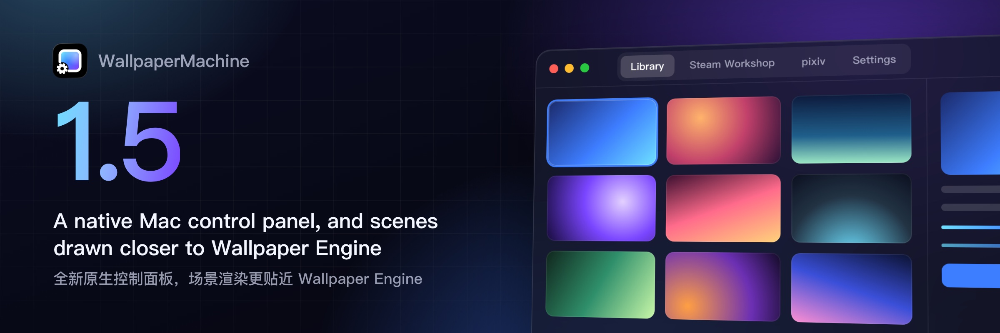
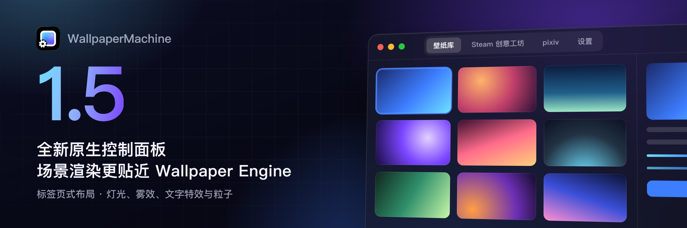

# Changelog

Every published version, newest first. Each section is written when its version is
cut, by [`scripts/release_notes.py`](scripts/release_notes.py) from the commits
between two version tags: a language model writes them up for users, where older
sections list the commits. Each section states the same notes in English and
Simplified Chinese. The app's What's New window offers both translations; the
GitHub Release body repeats only the English notes. See
[docs/release.md](docs/release.md) for how a version is cut.

## 1.5.3 — 2026-10-17

### English

This release brings a rebuilt native control panel and scene wallpapers drawn much closer to how they look in Wallpaper Engine

#### Highlights

- The control panel is now a native Mac window, with tabs for Library, Steam Workshop, pixiv and Settings
- Scene wallpapers look much closer to Wallpaper Engine, with scene lights, fog, camera shake and styled text
- 2D scenes are drawn at your display's resolution by default, so edges and fine detail stay sharp
- Audio visualizers, media widgets and cursor ripple and fluid effects now respond as their authors intended

#### Breaking changes

- Clicking a tag chip in Filters now shows only wallpapers with that tag; Option-click it or use its right-click menu to hide them instead

#### New

- The control panel is a native macOS window with Library, Steam Workshop, pixiv and Settings tabs on top and a Now Playing bar below
- Settings follows the layout of System Settings, with new icons, Quick Settings tiles and a search that finds any setting by its words
- Scenes now light their layers with point, spot, tube and directional lights and draw distance and height fog
- Text layers now show their outline, blur and drop shadow
- Camera shake and the editor's light shafts now appear in scenes that use them
- A new 2D scene resolution choice in Performance lets you keep Display resolution, the default, or draw at Canvas size as before
- Steam Workshop wallpaper details have a Share button, and About adds Share WallpaperMachine and Star on GitHub
- An optional Send performance data switch, off by default, sends a small daily report that helps find slow wallpapers and crashes
- What's New opens feature releases with a banner and Highlights, shown in the language you read the notes in

#### Improved

- Text layers use the fonts a wallpaper names, with stand-ins for Windows fonts, and lay out, align and size closer to Wallpaper Engine
- Particle effects such as snow, stars, leaves and code rain now appear at the size and place Wallpaper Engine gives them
- Wallpaper scripts get more of Wallpaper Engine 2.8's scripting features, so more interactive wallpapers set themselves up correctly
- Bloom and HDR follow Wallpaper Engine's passes and defaults, so glowing scenes look closer to the original
- Clocks, dates and song titles in scenes now move with camera parallax, which follows the cursor at Wallpaper Engine's speed
- Large pictures in scenes are drawn from their full-size image on high-resolution displays instead of a softer smaller copy
- Changing text in a scene, such as a ticking clock, updates far faster because its font is no longer read again each time
- Scrolling the wallpaper grids stays smooth, even with the details column open and animated previews playing
- Quick Settings and Playback & Power now say which battery, Low Power Mode or heat rule is pausing wallpapers or lowering quality
- Library, Steam Workshop and pixiv have a full-width search bar at the top and a Filters sidebar that slides out beside the grid
- The title bar shows WallpaperMachine and its version again and keeps one colour across every page

#### Fixed

- Web wallpapers no longer drag pictures onto the desktop or leave a ghost image that stops Finder's selection rectangle
- Audio visualizers and other web wallpapers that ask for an idle callback now start and react to sound
- AV1 videos inside scene wallpapers play again
- Videos in a scene carry on where they were when a clock or other text changes, instead of jumping back and stalling
- Cursor ripple and fluid simulation effects now move, and a click pushes them once instead of every frame the button is held
- Clicks in other apps, the menu bar or the Dock no longer count as clicks on the scene wallpaper behind them
- Media widgets hide while nothing plays, show their own cover art until a track starts and read the player's state correctly
- Layers whose scale, rotation or colour is animated now move and change instead of staying still
- Effects that failed to draw, such as some audio bars, colour grading and shadow effects, now show, and layers under them no longer vanish
- Text layers no longer vanish, sit too high, show a dark ring round their edges or show a placeholder instead of the time
- Pictures under post-processing layers fill the frame instead of showing only a quarter or a displaced copy
- Glows stay behind the 3D models in front of them, normal-mapped models light smoothly and fogged layers lose their vignette
- With Only play on the display I'm using on, other displays keep playing while a full-screen app covers the one you use
- Download rows in Downloads update at once when resumed, paused or finished, and Chinese progress shows its percent sign
- Searching Settings folds away an opened section that does not match instead of showing its contents without a title

### 简体中文

本次更新带来全新打造的原生控制面板，场景壁纸的呈现效果也更接近 Wallpaper Engine

#### 亮点

- 控制面板现已成为原生 Mac 窗口，可通过标签页在壁纸库、Steam 创意工坊、pixiv 和设置之间切换
- 场景壁纸的效果更接近 Wallpaper Engine，支持场景光源、雾效、镜头抖动和带样式的文字
- 2D 场景默认以显示器分辨率绘制，边缘和细节更加清晰
- 音频可视化、媒体小组件以及光标涟漪和流体效果现在会按作者的设计做出响应

#### 不兼容变更

- 现在点按“筛选”中的标签只会显示带有该标签的壁纸；如需隐藏，请按住 Option 点按或使用右键菜单

#### 新增

- 控制面板现为原生 macOS 窗口，顶部用标签页切换壁纸库、Steam 创意工坊、pixiv 和设置，底部显示“正在播放”栏
- 设置采用与系统设置相同的布局，配有新图标和快捷设置磁贴，还可按关键词搜索任意设置项
- 场景现在会用点光源、聚光灯、管状光源和平行光照亮图层，并绘制距离雾和高度雾
- 文字图层现在会显示描边、模糊和投影效果
- 使用镜头抖动和编辑器光束效果的场景现在会正确呈现它们
- “性能”中新增“2D 场景分辨率”选项，可保留默认的“显示器分辨率”，或像以前一样按“画布尺寸”绘制
- Steam 创意工坊壁纸详情新增“分享”按钮，“关于”中也加入了“分享 WallpaperMachine”和“在 GitHub 上加星标”
- 新增可选的“发送性能数据”开关，默认关闭，开启后每天发送一份简短报告，帮助找出运行缓慢的壁纸和崩溃问题
- “新功能”窗口会在功能版本开头显示横幅和亮点，语言与你阅读的更新说明一致

#### 改进

- 文字图层会使用壁纸指定的字体并为 Windows 字体提供替代，排版、对齐和大小也更接近 Wallpaper Engine
- 雪花、星星、落叶和代码雨等粒子效果现在会以与 Wallpaper Engine 相同的大小和位置出现
- 壁纸脚本可使用更多 Wallpaper Engine 2.8 的脚本功能，更多交互式壁纸能够正确完成初始化
- 泛光和 HDR 遵循 Wallpaper Engine 的处理方式与默认值，发光场景更接近原作效果
- 场景中的时钟、日期和歌曲名现在会随镜头视差移动，视差跟随光标的速度也与 Wallpaper Engine 相同
- 在高分辨率显示器上，场景中的大尺寸图片会使用原始尺寸绘制，不再显得模糊
- 场景中的文字更新（例如走动的时钟）大幅提速，因为不再每次都重新读取字体
- 即使打开了详情栏且动态预览正在播放，滚动壁纸网格也依然流畅
- 快捷设置和“播放与电源”现在会说明是哪条电池、低电量模式或温度规则暂停了壁纸或降低了画质
- 壁纸库、Steam 创意工坊和 pixiv 页面顶部新增通栏搜索栏，筛选器改为在网格旁滑出的侧边栏
- 标题栏重新显示 WallpaperMachine 及其版本号，并在所有页面保持统一颜色

#### 修复

- 网页壁纸不再会把图片拖到桌面上，也不会留下残影导致访达无法框选图标
- 请求空闲回调的音频可视化等网页壁纸现在可以正常启动并响应声音
- 场景壁纸中的 AV1 视频恢复正常播放
- 场景中的时钟等文字变化时，视频会从当前位置继续播放，不再跳回开头或卡顿
- 光标涟漪和流体模拟效果现在会动起来，每次点按只推动一次，而不是按住期间每帧都推动
- 在其他 App、菜单栏或程序坞中的点按不再被当作对背后场景壁纸的点按
- 没有播放时媒体小组件会自动隐藏，开始播放前显示默认封面，并能正确识别播放状态
- 设置了缩放、旋转或颜色动画的图层现在会正常变化，不再静止不动
- 部分音频条、调色和阴影等此前无法显示的效果现已正常呈现，其下方的图层也不再消失
- 文字图层不再消失、位置偏高、边缘出现暗圈，或显示占位文字而非时间
- 后期处理图层下方的图片现在会铺满画面，不再只显示四分之一或出现错位的副本
- 光晕会正确位于前方 3D 模型之后，法线贴图模型光照平滑，雾中图层也不再出现暗角
- 开启“仅在我正在使用的显示器上播放”后，当前显示器被全屏 App 遮挡时，其他显示器会继续播放
- 在“下载”中继续、暂停或完成下载时，对应条目会立即更新，中文进度也会显示百分号
- 搜索设置时，不匹配的已展开分组会自动收起，不再只显示内容而缺少标题

**Full changelog**: https://github.com/WallpaperMachine/WallpaperMachine/compare/v1.4.1...v1.5.3

## 1.5.2 — 2026-10-17

### English

WallpaperMachine 1.5.2 brings a rebuilt native control panel and scene wallpapers that look and behave much closer to how they do in Wallpaper Engine

#### Highlights

- The control panel is now a native Mac window, with Library, Steam Workshop, pixiv and Settings in tabs across the title bar
- Scene wallpapers look far closer to Wallpaper Engine, with lights, fog, camera shake, light shafts, styled text and more faithful particles
- 2D scenes are now drawn at your display's resolution, so edges and fine detail stay sharp
- Cursor ripples and fluid effects now move, and web audio visualizers that stayed blank now start and react to sound

#### Breaking changes

- Clicking a tag chip in Filters now shows only wallpapers with that tag; to hide a tag instead, Option-click it or choose Hide this tag
- The window sidebar is gone: pages are tabs in the title bar, and collections are managed in the Collections group of the Library's Filters

#### New

- A Filters sidebar slides out at the edge of Library, Steam Workshop and pixiv, and stays open as you move between them
- A Now Playing bar along the bottom of the window shows the current wallpaper; click it for a larger picture, its details and Show in library
- Settings is laid out like System Settings, with section cards, Quick Settings tiles, new icons and a search that finds any setting
- Settings > Performance adds a 2D scene resolution choice: Display resolution by default, or Canvas size to use less GPU time and memory
- Scenes with point, spot, tube and directional lights now light their layers, as in Wallpaper Engine
- Distance and height fog now appear in the scenes that use them
- Scenes that ask for camera shake now shake their view, following the wallpaper's own settings
- Light shafts drawn with the Wallpaper Engine editor's shape objects now show in scenes
- Text layers now show their outline, blur and drop shadow
- Layers that grow, turn or change colour over time in Wallpaper Engine now animate here too
- A Share button in a Workshop wallpaper's details opens the macOS share menu with its title and Workshop page
- Settings > About adds Share WallpaperMachine and Star on GitHub
- Send performance data, off until you turn it on, sends a small daily report without names, file paths or account details to help fix slowdowns and crashes
- The What's New window shows a release banner in the language you read the notes in, with bulleted entries and highlighted key features

#### Improved

- Wallpaper grids scroll without dropping frames, including beside the open inspector, and animated previews no longer slow scrolling
- Particle effects such as snow, stars and falling leaves open already populated and keep the size, place and motion Wallpaper Engine gives them
- Clocks and labels use the wallpaper's own fonts, with Mac stand-ins for Windows fonts, and sit, wrap and align where Wallpaper Engine puts them
- Text that changes often, such as a ticking clock, now updates far faster
- Bloom and HDR glow follow Wallpaper Engine's look, and scenes that leave bloom settings out now glow as they do there
- Camera parallax moves every layer, text included, at Wallpaper Engine's speed and distance, and cursor effects no longer lag behind the pointer
- Wallpaper scripts get Wallpaper Engine 2.8's scripting features, so more interactive scenes run as their authors made them
- Large pictures in 2D scenes stay sharp on displays a little smaller than them instead of being drawn from a half-size copy
- Settings now name the battery, Low Power Mode or heat rule that is pausing, stopping or lowering the quality of wallpapers
- Searching starts from a full-width bar at the top of Library, Steam Workshop and pixiv, and Command-F still jumps to it
- The title bar shows the WallpaperMachine name and version again and stays one colour across the window
- Filter groups fold open and closed with a short animation, staying instant under Reduce Motion

#### Fixed

- Dragging on a web wallpaper, including pixiv pictures, no longer drops copies of images onto the desktop or blocks Finder's selection rectangle
- Web audio visualizers such as osu!flower Enhanced no longer stay blank and now react to sound
- AV1 videos inside scene wallpapers play again
- Colour-grading, tone-mapping, audio bar, fluid and shadow effects that failed to load or hid their layer now draw again
- Cursor ripple and fluid effects now move and push harder while the mouse button is held
- A video inside a scene no longer jumps back to its start or stalls when a clock over it changes
- With Only play on the display I'm using on, other displays keep playing while a full-screen app covers the one you use
- Clicks in other windows, the menu bar or the Dock no longer count as clicks on the scene wallpaper behind them
- Media widgets hide while nothing is playing, show their own cover art until a track plays, and read the player's state correctly
- Pictures under post-processing layers now fill the frame, without the displaced copy or missing quarter some scenes showed
- Text layers that were invisible, or had a dark ring around enlarged letters, now show cleanly
- Lit models with normal maps no longer show hard highlight patches and sparkles, and glow layers stay behind the models in front of them
- Layers blended over the screen no longer appear upside down, and no longer vanish when drawn first on Native Metal
- Day and night wallpapers whose scripts switch effects or hidden layers now change their look as intended
- A resumed download in Downloads shows its progress at once instead of still saying it is paused
- Download progress in Simplified Chinese shows its percent sign again

### 简体中文

WallpaperMachine 1.5.2 带来全新重建的原生控制面板，场景壁纸的外观与表现也更接近 Wallpaper Engine

#### 亮点

- 控制面板已重建为原生 Mac 窗口，壁纸库、Steam 创意工坊、pixiv 和设置以标签页的形式排列在标题栏中
- 场景壁纸更接近 Wallpaper Engine 的效果，支持光照、雾效、镜头抖动、光束和文字样式，粒子也更加还原
- 2D 场景现在默认以显示器分辨率绘制，边缘和细节更加清晰
- 光标涟漪和流体效果现在会动起来，之前一片空白的网页音频可视化壁纸也能正常启动并随声音变化

#### 不兼容变更

- 在筛选中点按标签现在只显示带有该标签的壁纸；如需隐藏某个标签，请按住 Option 点按，或在右键菜单中选择“隐藏此标签”
- 窗口侧边栏已移除：各页面改为标题栏中的标签页，合集则在壁纸库筛选的“合集”分组中管理

#### 新增

- 壁纸库、Steam 创意工坊和 pixiv 页面的筛选改为从页面边缘滑出的侧边栏，在这些页面间切换时保持打开
- 窗口底部新增“正在播放”栏，点按即可查看大图、壁纸详情，并可在壁纸库中显示
- 设置采用与系统设置相同的布局，提供分区卡片、快捷设置磁贴、全新图标，以及可查找任意设置项的搜索
- 设置 > 性能新增“2D 场景分辨率”选项：默认使用显示器分辨率，也可选择画布尺寸以减少 GPU 时间和内存占用
- 场景中的点光源、聚光灯、管状光源和平行光现在会照亮图层，与 Wallpaper Engine 一致
- 使用了距离雾和高度雾的场景现在会正确显示雾效
- 开启了镜头抖动的场景现在会按照壁纸自身的设置晃动画面
- 用 Wallpaper Engine 编辑器形状对象绘制的光束现在会显示在场景中
- 文字图层现在会显示描边、模糊和投影
- 在 Wallpaper Engine 中会随时间缩放、旋转或变色的图层，现在也能正常播放动画
- Steam 创意工坊壁纸的详情中新增“共享”按钮，可通过 macOS 共享菜单分享壁纸标题和创意工坊页面
- 设置 > 关于新增“共享 WallpaperMachine”和“在 GitHub 上加星标”
- 新增“发送性能数据”选项，默认关闭；开启后每天发送一份不含名称、文件路径和账户信息的简短报告，帮助修复卡顿和崩溃
- “新功能”窗口会按你阅读的语言显示版本横幅，条目以列表呈现，主要功能会突出显示

#### 改进

- 壁纸网格滚动不再掉帧，打开检查器时也同样流畅，动态预览也不会再拖慢滚动
- 雪花、星星、落叶等粒子效果在开启时即已铺满画面，大小、位置和运动方式也与 Wallpaper Engine 一致
- 时钟和标签会使用壁纸自带的字体，Windows 字体由 Mac 上的相近字体代替，位置、换行和对齐方式与 Wallpaper Engine 一致
- 时钟等频繁变化的文字现在刷新得快多了
- 泛光和 HDR 光晕效果与 Wallpaper Engine 保持一致，未设置泛光参数的场景现在也会像在 Wallpaper Engine 中一样发光
- 镜头视差会以 Wallpaper Engine 的速度和幅度移动所有图层（包括文字），光标效果也不再落后于指针
- 壁纸脚本支持 Wallpaper Engine 2.8 的脚本功能，更多交互式场景能按作者的设计运行
- 2D 场景中的大尺寸图片在略小于图片的显示器上也能保持清晰，不再使用缩小一半的副本绘制
- 设置现在会指明是哪条电池、低电量模式或过热规则在暂停、停止壁纸或降低其画质
- 壁纸库、Steam 创意工坊和 pixiv 的搜索栏移至页面顶部并占满整行，仍可用 Command-F 快速定位
- 标题栏重新显示 WallpaperMachine 名称和版本号，并且整条标题栏颜色统一
- 筛选分组展开和收起时会有简短的动画，开启“减弱动态效果”时则立即切换

#### 修复

- 在网页壁纸（包括 pixiv 图片）上拖移时，不再会把图片副本拖到桌面上，也不再妨碍在访达中框选图标
- osu!flower Enhanced 等网页音频可视化壁纸不再一片空白，并能随声音变化
- 场景壁纸中的 AV1 视频可以再次正常播放
- 之前无法加载或导致图层消失的调色、色调映射、音频条、流体和阴影效果现在可以正常绘制
- 光标涟漪和流体效果现在会动起来，按住鼠标键时效果更强
- 场景中的视频不再因上方时钟变化而跳回开头或卡顿
- 开启“仅在我正在使用的显示器上播放”后，当前显示器被全屏 App 遮挡时，其他显示器会继续播放
- 在其他窗口、菜单栏或程序坞中点按时，不再会被当作点按了后方的场景壁纸
- 没有播放内容时媒体小组件会自动隐藏，在播放曲目前显示自带的封面图，并能正确识别播放器状态
- 后期处理图层下方的图片现在会铺满画面，不再出现部分场景中的错位副本或只显示四分之一的问题
- 之前不可见或放大后字母边缘有深色描边的文字图层，现在显示正常
- 带法线贴图的受光模型不再出现生硬的高光斑块和闪点，光晕图层也会正确位于前方模型之后
- 与屏幕混合的图层不再上下颠倒，在 Native Metal 下首先绘制时也不会再消失
- 通过脚本切换效果或隐藏图层的昼夜壁纸，现在能按预期切换外观
- 在“下载”中继续已暂停的下载项后，会立即显示进度，不再仍显示为已暂停
- 简体中文界面下的下载进度重新显示百分号

**Full changelog**: https://github.com/WallpaperMachine/WallpaperMachine/compare/v1.4.1...v1.5.2

## 1.5.1 — 2026-10-16

### English

This release rebuilds the control panel as a native macOS window and draws scene wallpapers much closer to how Wallpaper Engine shows them

#### Highlights

- The control panel is now a native Mac window, with pages in tabs across the title bar, a Filters sidebar and a Now Playing bar
- Scenes now show their lights, distance and height fog, camera shake and light shafts the way Wallpaper Engine draws them
- 2D scenes are drawn at your display's resolution by default, so edges and fine detail stay sharp
- Text layers gain outline, blur and drop shadow, with fonts, sizes and positions far closer to Wallpaper Engine
- Cursor ripples, fluid effects and music widgets now come to life in many more scene wallpapers

#### Breaking changes

- Clicking a tag chip in Filters now shows only wallpapers with that tag; Option-click it or use its right-click menu to hide the tag instead

#### New

- Scene wallpapers now light their layers with the point, spot, tube and directional lights they declare, without shadows
- Distance and height fog now appear in scenes that use them
- Text layers can show an outline, blur and drop shadow, as in Wallpaper Engine
- Choose 2D scene resolution in Settings > Performance: Display resolution by default, or Canvas size to use less GPU time and memory
- Scenes that ask for camera shake now shake their view as they do in Wallpaper Engine
- Light shafts and other shape objects from the Wallpaper Engine editor now appear in scenes
- Wallpaper scripts get much more of Wallpaper Engine 2.8's scripting features, so more interactive scenes run as their authors intended
- Share a Steam Workshop wallpaper from its details, or share WallpaperMachine and star it on GitHub from Settings > About
- An optional Send performance data switch, off until you turn it on, sends a small daily report that helps find slow wallpapers and crashes
- The What's New window opens feature releases with a banner and highlights in the language you read the notes in

#### Improved

- The control panel looks and behaves like a Mac app, with system controls, VoiceOver labels and Settings laid out like System Settings with new icons
- Library, Steam Workshop, pixiv and Settings sit in tabs across the title bar, with the playing wallpaper in a bar along the bottom
- Filters open in a sidebar that slides out beside the grid, and each page has a full-width search bar at the top
- Wallpaper grids scroll more smoothly, even with the details column open and previews playing
- Settings now names the battery, Low Power Mode or heat rule that is pausing wallpapers or lowering their quality, and the frame rate it sets
- Text layers use the fonts, sizes, line spacing and alignment Wallpaper Engine gives them, and enlarged text no longer has a dark ring
- Particle systems spawn, move, scale and fade as in Wallpaper Engine, so snow, leaves and stars no longer shrink, vanish or start partway down
- Camera parallax moves layers at Wallpaper Engine's speed and distance, and clocks and other text labels now move with the layers around them
- Bloom and HDR follow Wallpaper Engine's defaults and settings, including scenes that adjust them through wallpaper properties
- Large pictures in scenes are drawn from their full-size image, so they look as sharp as in Wallpaper Engine
- Clocks and other changing text update quickly without reloading their font every time

#### Fixed

- Cursor ripples and fluid effects now move, react once per click and respond only to presses on the desktop, not in other windows
- Music widgets hide while nothing plays, show their default cover art and read the player's state correctly
- Effects that failed to draw, such as audio bars, colour grading, shadows and fluid simulations, now appear
- Scripted clocks, day and night switches, layer colours and fades now show what their scripts set
- Layers animated to grow, turn or change colour now play those animations instead of standing still
- Scenes with full-screen post-processing layers fill the frame instead of showing a shifted or quarter-size picture
- A video inside a scene no longer jumps back to its start or stalls when a clock or other text over it changes size
- AV1 videos inside scenes play again
- Lit 3D models show smooth highlights, and glows stay behind the models in front of them
- Dragging on a web wallpaper no longer drops a copy of its picture onto the desktop or blocks selecting icons in Finder
- Web wallpapers such as some audio visualizers that stopped at start-up now start and react to sound
- With Only play on the display I'm using on, other displays keep playing while a full-screen app covers the one you use
- Resuming, pausing or finishing a download updates its row in the Downloads list right away
- Download progress in Simplified Chinese shows its percent sign again
- Searching Settings no longer leaves an open section's contents showing without its title

### 简体中文

本次更新将控制面板重新打造为原生 macOS 窗口，场景壁纸的呈现效果也更接近 Wallpaper Engine

#### 亮点

- 控制面板改为原生 Mac 窗口，各页面以标签排列在标题栏，并配有筛选边栏和正在播放栏
- 场景现在会像 Wallpaper Engine 一样呈现灯光、距离雾与高度雾、镜头晃动和光束
- 2D 场景默认按显示器分辨率绘制，边缘和细节更加清晰
- 文字图层支持描边、模糊和投影，字体、大小与位置也更贴近 Wallpaper Engine
- 鼠标涟漪、流体效果和音乐小组件如今能在更多场景壁纸中正常动起来

#### 不兼容变更

- 点击筛选中的标签现在只显示带有该标签的壁纸，如需隐藏该标签，请按住 Option 点击或使用右键菜单

#### 新增

- 场景壁纸现在会用其设置的点光源、聚光灯、管状光源和平行光照亮图层，暂不绘制阴影
- 使用距离雾和高度雾的场景现在会显示雾效
- 文字图层可以像在 Wallpaper Engine 中一样显示描边、模糊和投影
- 可在“设置 > 性能”中选择 2D 场景分辨率，默认为显示器分辨率，选择画布尺寸可减少 GPU 时间和内存占用
- 设置了镜头晃动的场景现在会像在 Wallpaper Engine 中一样晃动画面
- Wallpaper Engine 编辑器中的光束等形状对象现在会在场景中显示
- 壁纸脚本可使用更多 Wallpaper Engine 2.8 的脚本功能，更多互动场景能按作者的设计运行
- 可在 Steam 创意工坊壁纸的详情中分享壁纸，也可在“设置 > 关于”中分享 WallpaperMachine 或在 GitHub 上为其加星
- 新增可选的“发送性能数据”开关，默认关闭，开启后每天发送一份简短报告，帮助找出运行缓慢的壁纸和崩溃问题
- “新功能”窗口会以横幅和亮点开启功能版本的说明，并跟随你阅读的语言显示

#### 改进

- 控制面板的外观和操作与 Mac 应用一致，采用系统控件和 VoiceOver 标签，设置页面仿照系统设置布局并换上新图标
- 壁纸库、Steam 创意工坊、pixiv 和设置以标签排列在标题栏，正在播放的壁纸显示在窗口底部栏中
- 筛选条件改在网格旁滑出的边栏中显示，各页面顶部也有通栏搜索栏
- 壁纸网格滚动更流畅，即使打开详情栏或预览正在播放时也是如此
- 设置现在会指明是哪条电池、低电量模式或过热规则在暂停壁纸或降低画质，以及它限制的帧率
- 文字图层采用与 Wallpaper Engine 一致的字体、大小、行距和对齐方式，放大的文字也不再带有暗色描边
- 粒子的生成、运动、缩放和淡出方式与 Wallpaper Engine 一致，雪花、落叶和星星不再缩小、消失或从画面中途出现
- 镜头视差移动图层的速度和距离与 Wallpaper Engine 一致，时钟等文字标签也会随周围图层一起移动
- 泛光和 HDR 遵循 Wallpaper Engine 的默认值和设置，包括通过壁纸属性调整它们的场景
- 场景中的大尺寸图片改用原尺寸图像绘制，清晰度与 Wallpaper Engine 相当
- 时钟等不断变化的文字更新更迅速，不再每次都重新读取字体

#### 修复

- 鼠标涟漪和流体效果现在会正常运动，每次点击只响应一次，且只响应桌面上的点击，不再响应其他窗口中的操作
- 音乐小组件在未播放时会隐藏，显示默认封面，并能正确读取播放状态
- 音频条、调色、阴影和流体模拟等此前无法绘制的效果现在会正常显示
- 由脚本控制的时钟、昼夜切换以及图层颜色和淡入淡出现在会正确显示
- 设置了缩放、旋转或颜色动画的图层现在会正常播放，不再静止不动
- 带有全屏后期处理图层的场景现在能铺满画面，不再出现错位或只显示四分之一的画面
- 场景中的视频不再因其上的时钟等文字改变大小而跳回开头或卡顿
- 场景中的 AV1 视频可以再次播放
- 受光照的 3D 模型高光更平滑，光晕也会正确位于前方模型之后
- 在网页壁纸上拖动时，不再把图片副本拖到桌面上，也不会妨碍在访达中框选图标
- 部分启动时就停止的网页壁纸（如某些音频可视化效果）现在能正常启动并响应声音
- 开启“仅在我正在使用的显示器上播放”后，当前显示器被全屏应用遮挡时，其他显示器会继续播放
- 在下载列表中恢复、暂停或完成下载时，对应条目会立即更新
- 简体中文界面下的下载进度会重新显示百分号
- 搜索设置时，已展开分组的内容不再在标题隐藏后仍然显示

**Full changelog**: https://github.com/WallpaperMachine/WallpaperMachine/compare/v1.4.1...v1.5.1

## 1.5.0 — 2026-10-16

### English

WallpaperMachine 1.5.0 brings a rebuilt native macOS control panel and draws scene wallpapers far closer to how they look in Wallpaper Engine

#### Highlights

- The control panel is now a native macOS window, with Library, Steam Workshop, pixiv and Settings as tabs across the top
- Scene wallpapers look much closer to Wallpaper Engine, with real lights, fog, camera shake and text outlines and shadows
- 2D scenes are drawn at your display's resolution, so edges and fine detail stay sharp
- Cursor ripples, fluid effects, media widgets and scripted wallpapers now behave the way their authors intended

#### New

- The control panel is now a native macOS window, with Library, Steam Workshop, pixiv and Settings as tabs in the title bar
- Scene wallpapers now light their layers with point, spot, tube and directional lights and draw distance and height fog
- Text layers such as clocks and dates now show their outline, blur and drop shadow
- 2D scenes are drawn at your display's resolution for sharper detail, and a Canvas size choice in Settings > Performance keeps the previous lighter load
- Scenes that ask for camera shake now shake their camera, and the editor's light shafts appear on screen
- Wallpaper scripts get the scripting features of Wallpaper Engine 2.8, so more interactive and widget wallpapers run as intended
- A bar along the bottom of the window shows what is playing now and opens a larger view with its details
- Library filters now open in a sidebar that slides out beside the grid, with your collections managed in its Collections group
- Steam Workshop wallpaper details have a Share button, and About adds Share WallpaperMachine and Star on GitHub
- An optional Send performance data switch, off by default, sends a small daily report that helps find slow wallpapers and crashes
- What's New opens feature releases with a banner and highlights, shown in the language you read the notes in

#### Improved

- Settings is laid out like System Settings, with new icons, a search that finds any setting and Quick Settings tiles for common switches
- Wallpaper grids scroll more smoothly, even with Wallpaper details open and animated previews playing
- When a battery, Low Power Mode or heat rule pauses wallpapers or lowers their quality, Settings now tells you which rule is responsible
- Particles such as snow, falling leaves and stars now spawn, size and move the way Wallpaper Engine 2.8 draws them
- Text in scenes is laid out, aligned and drawn in the wallpaper's own fonts as in Wallpaper Engine, with matching stand-ins for Windows fonts
- Bloom, HDR and camera parallax follow Wallpaper Engine's rules, and text labels now move with the parallax like other layers
- Clocks and other text that changes often update much faster
- Large pictures in 2D scenes stay sharp on high-resolution displays instead of being drawn from a smaller copy
- More scenes now stay on the default Native Metal renderer instead of switching to Compatibility
- Clicking a tag in Filters now shows only wallpapers with that tag, and Option-click hides it instead
- Library, Steam Workshop and pixiv each have a full-width search bar at the top of the page, still reachable with Command-F

#### Fixed

- Cursor ripple and fluid effects now react to the pointer and clicks, and wallpapers using the fluid simulation effect show it again
- Media widgets hide while nothing is playing, show their own cover art until a track starts and read play and pause correctly
- Layers animated in size, rotation or colour now move and change the way their author keyed them
- Dragging on a web wallpaper no longer drops copies of pictures onto the desktop or stops Finder's selection rectangle
- Web wallpapers that wait for an idle moment, such as the osu!flower Enhanced visualizer, now start and react to sound
- Clicks in other apps, the menu bar or the Dock no longer reach the scene wallpaper behind them
- With Only play on the display I'm using on, other displays keep playing while the one you use is covered by a full-screen app
- Videos inside scenes no longer jump back to the start or stall when a clock over them changes, and AV1 videos play again
- Post-processing layers no longer show a shifted or partial picture, so scenes like DJgun's rainy night fill the screen again
- Effects such as colour grading, audio bars, shadows and screen blending that failed to draw now appear as intended
- Lit 3D models no longer show hard highlight patches or sparkles, and glows stay behind the models in front of them
- Day and night wallpapers driven by scripts now switch their look as they do in Wallpaper Engine
- Enlarged pixel-font text no longer has a dark ring round its edges, and text with all its effects off shows again
- Resuming, pausing or finishing a download now updates its row in Downloads straight away
- Download progress in Simplified Chinese shows its percent sign again

### 简体中文

WallpaperMachine 1.5.0 带来全新打造的原生 macOS 控制面板，场景壁纸的呈现效果也更加接近 Wallpaper Engine

#### 亮点

- 控制面板现已重新打造为原生 macOS 窗口，壁纸库、Steam 创意工坊、pixiv 和设置以标签页排列在窗口顶部
- 场景壁纸的效果更接近 Wallpaper Engine，支持真实光源、雾效、镜头晃动，以及文字描边和阴影
- 2D 场景现在按显示器分辨率绘制，边缘和细节更加清晰锐利
- 光标涟漪、流体效果、媒体小组件和带脚本的壁纸现在都能按作者的设计正常运行

#### 新增

- 控制面板现已改为原生 macOS 窗口，壁纸库、Steam 创意工坊、pixiv 和设置以标签页显示在标题栏中
- 场景壁纸现在支持点光源、聚光灯、管状光源和平行光照亮图层，并能绘制距离雾和高度雾
- 时钟、日期等文字图层现在能显示描边、模糊和投影效果
- 2D 场景现在按显示器分辨率绘制，细节更清晰；如需保持以往较低的负载，可在“设置 > 性能”中选择“画布尺寸”
- 设置了镜头晃动的场景现在会晃动镜头，编辑器中制作的光束效果也会显示出来
- 壁纸脚本现已支持 Wallpaper Engine 2.8 的脚本功能，更多互动类和小组件类壁纸可以正常运行
- 窗口底部新增正在播放栏，点按即可查看更大的预览和壁纸详情
- 壁纸库的筛选条件现在显示在可滑出的侧边栏中，合集也可以在其中的“合集”分组里管理
- Steam 创意工坊壁纸详情中新增“分享”按钮，“关于”中新增“分享 WallpaperMachine”和“在 GitHub 上加星标”
- 新增可选的“发送性能数据”开关，默认关闭，开启后每天发送一份简短报告，帮助发现运行缓慢的壁纸和崩溃问题
- “新功能”窗口会在功能版本的说明顶部显示横幅和亮点，并以你阅读说明所用的语言呈现

#### 改进

- 设置界面改为与系统设置一致的布局，配有全新图标，可搜索任意设置项，常用开关集中在快捷设置中
- 即使打开了壁纸详情或正在播放动态预览，壁纸网格的滚动也更加流畅
- 当电池、低电量模式或发热规则暂停壁纸或降低画质时，设置中现在会说明是哪条规则在起作用
- 雪花、落叶、星星等粒子的生成、大小和运动方式现在与 Wallpaper Engine 2.8 保持一致
- 场景中的文字现在按 Wallpaper Engine 的方式排版、对齐，并使用壁纸自带字体绘制，Windows 字体也有相应的替代字体
- 泛光、HDR 和镜头视差现在遵循 Wallpaper Engine 的规则，文字标签也会像其他图层一样随视差移动
- 时钟等频繁变化的文字现在更新速度大幅提升
- 2D 场景中的大尺寸图片在高分辨率显示器上不再使用缩小版本绘制，画面保持清晰
- 更多场景现在会继续使用默认的 Native Metal 渲染器，而不再切换到兼容模式
- 现在点按筛选中的标签只显示带有该标签的壁纸，按住 Option 键点按则隐藏该标签
- 壁纸库、Steam 创意工坊和 pixiv 页面顶部均有通栏搜索框，仍可使用 Command-F 快速定位

#### 修复

- 光标涟漪和流体效果现在会响应指针和点按，使用流体模拟效果的壁纸也能重新正常显示
- 媒体小组件在没有播放时会自动隐藏，曲目开始前显示自带封面，并能正确识别播放和暂停状态
- 设置了大小、旋转或颜色动画的图层现在会按作者设定的关键帧变化
- 在网页壁纸上拖移时，不再会把图片副本放到桌面上，也不会再导致访达无法框选图标
- 依赖空闲回调的网页壁纸（如 osu!flower Enhanced 音频可视化）现在能正常启动并响应声音
- 在其他 App、菜单栏或程序坞中的点按不再传递给后方的场景壁纸
- 开启“仅在我正在使用的显示器上播放”后，当前显示器被全屏 App 遮挡时，其他显示器会继续播放
- 场景中的视频不再因上方时钟变化而跳回开头或卡顿，AV1 视频也能重新正常播放
- 后期处理图层不再显示错位或残缺的画面，DJgun 的雨夜等场景重新铺满整个屏幕
- 调色、音频条、阴影、屏幕混合等此前无法绘制的效果现在可以正常显示
- 受光照的 3D 模型不再出现生硬的高光块或闪点，光晕也会正确地留在前方模型之后
- 由脚本控制的昼夜切换壁纸现在会像在 Wallpaper Engine 中一样切换画面
- 放大显示的像素字体边缘不再出现深色描边，关闭全部效果的文字也能重新显示
- 继续、暂停或完成下载后，“下载”列表中的对应条目会立即更新
- 简体中文界面中的下载进度重新显示百分号

**Full changelog**: https://github.com/WallpaperMachine/WallpaperMachine/compare/v1.4.1...v1.5.0

## 1.4.1 — 2026-10-14

### English

Native Metal becomes the default scene renderer, live property previews and wallpaper positioning arrive, and many scene, video, experimental lock screen and Workshop download problems are fixed

#### Breaking changes

- Scene wallpapers now play on the Native Metal renderer by default, switched once on first launch; choose Compatibility in Performance settings to keep the previous renderer

#### New

- The Wallpaper Preview window now follows property edits as you make them, including sliders and colors while you drag, without reloading or touching your desktop
- An optional setting, off by default, shows a scene wallpaper's property edits on your desktop as you make them, before you apply changes
- Scene and video wallpapers can now be moved on each display with Horizontal position and Vertical position sliders in the inspector, following the slider live
- In Settings > Performance > Playback, Low Power Mode, heat and low battery can now switch wallpapers to reduced quality instead of pausing or stopping them
- A new When the battery is low rule, off by default, pauses or stops wallpapers on battery at 10%, 20% or 30% charge
- An optional Playback switch, off by default, keeps playing only the display your pointer is on and pauses the others
- Mute Wallpapers silences every wallpaper at once from the menu bar, Settings, links, Shortcuts or a shortcut key, without changing saved volumes
- Random Wallpaper picks a different wallpaper for a display from all or only favorites, from the menu bar, links, Shortcuts or a shortcut key
- With two or more displays, the menu bar menu has a submenu for each display with Previous, Next, Recently used and Remove from Display
- Apply to all displays sets a wallpaper on every display in one step from the inspector, a link or Shortcuts
- Workshop wallpapers in Discover can now be downloaded and applied to the target display in one step
- Pasting a Workshop item link or id into the Discover search box now shows that item directly instead of searching for the text
- Discover has a new Recently updated sort that lists wallpapers by when they last changed
- Playlists can now change wallpaper each time the Mac is unlocked
- A new switch in Settings > General lets you stop WallpaperMachine from changing the macOS desktop picture, so Mission Control keeps your own picture
- Installed Workshop wallpapers can be reinstalled from the Workshop, keeping your options and the current copy until the new download completes
- Wallpaper properties have a Restore all defaults link that resets every setting to the artist's values in one click
- The inspector can check an installed video for baked-in black bars and set the scale factor that crops them in Fill mode
- Import finds projects in Wallpaper Engine and Steam library folders, accepts a project's own files, recognizes renamed Workshop projects and can replace changed ones
- Wallpaper settings now show the wallpaper's own translated names, and built-in Wallpaper Engine identifiers appear as readable words
- Workshop downloads now show the time left, and the menu bar menu shows how many downloads are running and their progress
- A wallpaper that crashed the app twice while loading is held back at launch, and a banner names it with a Try again button
- A scene that stopped after a rendering failure has a Retry button in the live diagnostics of Performance settings
- On a MacBook, the inspector's energy rating also shows about how much of a full battery charge a wallpaper uses per hour
- An optional switch, off by default, lets Safari's Web Inspector debug web wallpapers
- The diagnostics report now includes macOS resource and hang reports, the wallpaper load history and memory use, and the log explains why wallpapers changed

#### Improved

- Switching to a scene, web page or video on the optional native video playback now keeps the previous picture until the new one appears, instead of flashing black
- Native Metal now draws wallpapers with scene lights, motion trails, fluid and ripple effects and perspective effects instead of handing them to Compatibility
- Customizable scene wallpapers no longer hold memory for layers their settings hide, and Native Metal needs less image memory for heavy wallpapers
- Web wallpapers now honor the frame-rate limit and Internal render scale, and can follow a fast display's full refresh rate when you choose it
- Reapply wallpaper now restarts the wallpaper on the display, so a frozen or blank wallpaper can be revived without choosing another
- Installed tiles show still covers and animate only the preview under the pointer, so a large library no longer keeps the panel busy
- Installed keeps its search, sort, filters and scroll position when you close and reopen the control panel
- The inspector now shows Displays and Collections before a wallpaper's properties, so long property lists no longer push them out of reach
- Property groups now appear as section headings, making long property lists easier to scan
- The Wallpaper Preview window now shows the wallpaper in the shape of the display it previews for
- When launched at login, WallpaperMachine now waits in the menu bar instead of opening the control panel
- Discover keeps listing wallpapers when Steam changes its Workshop page, with a note that the list may be incomplete
- Importing a project identical to one already installed now skips it instead of copying it again
- Backups no longer include the saved Steam sign-in, partial downloads or thumbnail caches, while your library is still backed up
- The update available alert now waits until wallpapers are showing again instead of appearing over full-screen apps or the locked screen

#### Fixed

- Many Workshop effects that were silently missing now appear, including water caustics, sine wave, pixelate, audio bars, color grading, halftone, procedural noise and progress bars
- Image layer colors chosen by a preset or your settings, and effects your settings switch on or off, now take effect
- Wallpapers that change with the time of day now show the right picture instead of a clock on a black screen
- Scene wallpapers whose scripts check the device, create layers from a model or rebuild their layers now run those scripts, so missing bars and elements appear
- Text, clock, scan-line, wave and compose layer effects that read other layers or themselves now show instead of being blank or missing
- A scene that stops after a rendering error, or after the Mac wakes, now restarts by itself instead of staying frozen
- On Native Metal, 3D models no longer show hidden faces, parallax follows the cursor at the right speed and depth matches Compatibility
- Clearing the shader cache while a wallpaper loaded on Native Metal no longer crashes the app
- A scene wallpaper that fails to load no longer leaves the display black, and the previous wallpaper stays
- Trails and echo effects no longer freeze partway with Update only when the scene changes turned on
- Playlists no longer refill a display you cleared, replace a wallpaper you just chose, or forget their shuffle round after a relaunch
- With optional native video playback, Fit, Original size and the scale factor now work, and portrait clips show upright in Mission Control
- With optional native video playback, a clip that freezes after wake or never shows a picture is repaired or handed to Compatibility instead of staying black
- With optional native video playback, a sleeping disk no longer holds up other displays and switching quickly no longer flashes the wallpapers in between
- The experimental animated lock screen no longer goes black or loses its wallpaper because of a stale renderer or unanswered system requests
- Turning on the experimental animated lock screen now explains a switched-off renderer and ends leftover renderers instead of timing out
- The experimental animated lock screen no longer stays frozen after a missed wake, and one sleeping display no longer pauses another
- On macOS 27, Mission Control shows the wallpaper picture again, and quitting is no longer blocked by a desktop picture macOS holds on to
- Quitting, logging out, restarting and shutting down no longer hang while the desktop picture is restored, and a failed restore is explained
- Stopping the app from Terminal now restores the desktop picture first, and an import file picker closing early no longer ends the app
- Workshop downloads retry a dropped connection, restart after the Mac wakes and check free space first instead of stalling or blaming your purchase
- Download progress no longer jumps backwards, and a preset whose base wallpaper failed to download now says so clearly
- Audio-reactive wallpapers recover after you switch the output device, such as connecting headphones
- A display that briefly drops out or reports no size while connecting no longer reloads wallpapers or makes applying fail on other displays
- Plugging in or unplugging the charger while the Mac sleeps is now noticed on wake, so battery settings apply correctly
- Opening a second copy of WallpaperMachine now brings the running one forward instead of sharing the library with it
- The control panel and its windows open on the current Space, and a minimized panel comes back when you open it
- Launch at login now explains when WallpaperMachine must be allowed in Login Items and offers a button to open them
- Wallpaper settings that depend on other options now show and hide correctly for more of Wallpaper Engine's rules
- Web wallpapers that load files inside a frame no longer stall, and audio visualizers no longer freeze mid-decay when music stops
- Paused web wallpapers are now actually suspended, even when the page ignores the pause
- Web wallpapers now receive only changed properties after the first update, so pages no longer redo setup on every edit
- On a MacBook with macOS 27, Energy use in Performance settings shows the battery share per hour again

### 简体中文

Native Metal 成为默认场景渲染器，新增实时属性预览和壁纸位置调整，并修复了大量场景、视频、实验性锁定屏幕和 Workshop 下载问题

#### 不兼容变更

- 场景壁纸现在默认使用 Native Metal 渲染器，首次启动时会自动切换一次；如需继续使用原渲染器，请在性能设置中选择兼容渲染器

#### 新增

- 壁纸预览窗口现在会随你编辑属性实时更新，拖动滑块和颜色时也会跟随，且不会重新载入或影响桌面
- 新增可选设置（默认关闭），可在应用更改之前就把场景壁纸的属性编辑实时显示在桌面上
- 现在可以在检查器中用水平位置和垂直位置滑块调整场景和视频壁纸在每台显示器上的位置，拖动时实时跟随
- 在 设置 > 性能 > 播放 中，低电量模式、Mac 过热和电池电量低时现在可以选择降低画质，而不是暂停或停止壁纸
- 新增电池电量低规则（默认关闭），可在电池供电且电量降至 10%、20% 或 30% 时暂停或停止壁纸
- 播放中新增可选开关（默认关闭），只让指针所在的显示器继续播放，其他显示器暂停
- 静音壁纸功能可从菜单栏、设置、链接、快捷指令或快捷键一次静音所有壁纸，且不改变已保存的音量
- 随机壁纸可从全部壁纸或仅收藏中为显示器换一张不同的壁纸，可通过菜单栏、链接、快捷指令或快捷键使用
- 连接两台或更多显示器时，菜单栏菜单为每台显示器提供子菜单，包含上一张、下一张、最近使用和从显示器移除
- 应用到所有显示器可通过检查器、链接或快捷指令一步将壁纸应用到每台显示器
- 发现中的 Workshop 壁纸现在可以一步完成下载并应用到目标显示器
- 在发现的搜索框中粘贴 Workshop 项目链接或编号，现在会直接显示该项目，而不是按文字搜索
- 发现新增最近更新排序，按壁纸最后更新时间列出
- 播放列表现在可以在每次解锁 Mac 时更换壁纸
- 设置 > 通用 中新增开关，可让 WallpaperMachine 不再更改 macOS 桌面图片，使调度中心保留你自己的图片
- 已安装的 Workshop 壁纸可以从 Workshop 重新安装，保留你的选项，并在新下载完成前保留当前副本
- 壁纸属性新增恢复全部默认值链接，一键将所有设置恢复为作者设定的值
- 检查器可以检查已安装视频中是否有内嵌黑边，并设置在填充模式下裁掉黑边的缩放比例
- 导入现在能在 Wallpaper Engine 和 Steam 资料库文件夹中找到项目，接受项目自身的文件，识别改名的 Workshop 项目，并可替换已更改的项目
- 壁纸设置现在显示壁纸自带的翻译名称，Wallpaper Engine 内置标识符也会显示为可读的文字
- Workshop 下载现在会显示剩余时间，菜单栏菜单也会显示正在进行的下载数量和进度
- 加载时两次导致应用崩溃的壁纸会在启动时暂缓载入，并有横幅指出该壁纸并提供重试按钮
- 因渲染失败而停止的场景会在性能设置的实时诊断中提供重试按钮
- 在 MacBook 上，检查器的能耗评级还会显示壁纸每小时大约消耗多少电池电量
- 新增可选开关（默认关闭），允许用 Safari 的 Web 检查器调试网页壁纸
- 诊断报告现在包含 macOS 资源和无响应报告、壁纸载入记录和内存占用，日志也会说明壁纸为何更换

#### 改进

- 切换到场景、网页或可选原生视频播放中的视频时，现在会保留上一张画面直到新壁纸出现，不再黑屏闪烁
- Native Metal 现在可以绘制带场景光照、运动拖尾、流体和涟漪效果以及透视效果的壁纸，不再交给兼容渲染器
- 可自定义的场景壁纸不再为设置隐藏的图层占用内存，Native Metal 绘制复杂壁纸所需的图像内存也更少
- 网页壁纸现在遵循帧率上限和内部渲染比例，并可在你选择时跟随高刷新率显示器的完整刷新率
- 重新应用壁纸现在会在显示器上重启该壁纸，无需先选择其他壁纸即可恢复卡住或空白的壁纸
- 已安装中的缩略图显示静态封面，只播放指针所在的预览，大型壁纸库不再让面板一直忙碌
- 关闭并重新打开控制面板时，已安装会保留搜索、排序、筛选和滚动位置
- 检查器现在把显示器和收藏集放在壁纸属性之前，较长的属性列表不再把它们挤到远处
- 属性分组现在显示为分节标题，让较长的属性列表更易浏览
- 壁纸预览窗口现在按所预览显示器的比例显示壁纸
- 登录时启动后，WallpaperMachine 现在会停留在菜单栏，而不会自动打开控制面板
- Steam 更改 Workshop 页面时，发现仍会列出壁纸，并提示列表可能不完整
- 导入与已安装项目完全相同的内容时，现在会跳过而不再重复复制
- 备份不再包含已保存的 Steam 登录信息、未完成的下载和缩略图缓存，壁纸库仍会照常备份
- 有可用更新的提醒现在会等到壁纸重新显示时再出现，不再弹在全屏应用或锁定屏幕上方

#### 修复

- 许多此前被悄悄略过的 Workshop 效果现在会显示，包括水面焦散、正弦波、像素化、音频条、调色、半色调、程序噪声和进度条
- 由预设或你的设置选择的图层颜色，以及设置中开关的效果，现在都会生效
- 随一天时间变化的壁纸现在会显示对应画面，不再只在黑屏上显示时钟
- 脚本会检查设备、从模型创建图层或重建图层的场景壁纸，现在能正常运行这些脚本，缺失的音频条和元素会显示出来
- 读取其他图层或自身的文字、时钟、扫描线、波形和组合图层效果现在会正常显示，不再空白或缺失
- 因渲染错误或 Mac 唤醒后停止的场景现在会自动重新启动，而不是一直卡住
- 在 Native Metal 上，3D 模型不再显示应隐藏的面，视差以正确速度跟随指针，深度表现与兼容渲染器一致
- 在 Native Metal 载入壁纸时清除着色器缓存不再导致应用崩溃
- 场景壁纸载入失败时不再让显示器变黑，会保留之前的壁纸
- 开启仅在场景变化时更新后，拖尾和回声效果不再中途冻结
- 播放列表不再为你清空的显示器重新放入壁纸，不再替换你刚选择的壁纸，重启后也不会忘记随机轮次
- 使用可选的原生视频播放时，适应、原始大小和缩放比例现在都能生效，竖拍视频在调度中心中也会正立显示
- 使用可选的原生视频播放时，唤醒后冻结或始终不出画面的视频会被修复或交给兼容模式，不再一直黑屏
- 使用可选的原生视频播放时，休眠的磁盘不再拖慢其他显示器，快速切换时也不再闪现中间的壁纸
- 实验性的动态锁定屏幕不再因旧的渲染进程或未响应的系统请求而变黑或丢失壁纸
- 开启实验性的动态锁定屏幕时，现在会说明渲染器已被关闭并结束残留的渲染进程，不再等待超时
- 实验性的动态锁定屏幕在漏掉唤醒通知后不再冻结，一台显示器休眠也不再暂停另一台
- 在 macOS 27 上，调度中心重新显示壁纸画面，退出也不再被 macOS 保留的桌面图片阻止
- 退出、注销、重启和关机时不再因恢复桌面图片而卡住，恢复失败时也会给出说明
- 从终端停止应用时现在会先恢复桌面图片，导入文件选择器提前关闭也不再导致应用退出
- Workshop 下载会在连接中断时重试、在 Mac 唤醒后重新开始，并预先检查可用空间，不再卡住或误报购买问题
- 下载进度不再倒退，预设的基础壁纸下载失败时现在也会明确说明
- 切换输出设备后（例如连接耳机），音频响应壁纸会恢复正常
- 短暂断开或连接时未报告尺寸的显示器，不再导致壁纸重新载入或在其他显示器上应用失败
- 在 Mac 睡眠时插拔充电器，现在会在唤醒时被识别，电池相关设置会正确生效
- 打开第二个 WallpaperMachine 副本时，现在会把正在运行的副本调到前台，而不是与其共用壁纸库
- 控制面板及其窗口会在当前空间中打开，最小化的面板在你打开时也会恢复
- 登录时启动现在会说明何时需要在登录项中允许 WallpaperMachine，并提供打开登录项的按钮
- 依赖其他选项的壁纸设置现在能按更多 Wallpaper Engine 规则正确显示和隐藏
- 在框架内载入文件的网页壁纸不再卡住，音乐停止时音频可视化也不再在衰减中途冻结
- 暂停的网页壁纸现在会被真正挂起，即使网页本身忽略暂停请求
- 网页壁纸在首次更新后只接收已更改的属性，网页不再在每次编辑时重复初始化
- 在运行 macOS 27 的 MacBook 上，性能设置中的能耗再次显示每小时电池占比

**Full changelog**: https://github.com/WallpaperMachine/WallpaperMachine/compare/v1.3.3...v1.4.1

## 1.4.0 — 2026-10-13

### English

WallpaperMachine 1.4.0 makes Native Metal the default scene renderer, lets you see property edits and position wallpapers live, and adds menu bar, playlist and download controls

#### Breaking changes

- Scene wallpapers now play on the Native Metal renderer by default, and you can choose Compatibility again in Settings > Performance

#### New

- An optional setting, off by default, shows a scene wallpaper's property edits on the desktop as you make them, before you apply them
- The Wallpaper Preview window now follows property edits for scene and web wallpapers, including sliders and colors while you drag them
- New Horizontal position and Vertical position sliders set where a scene or video wallpaper sits on each display, and the wallpaper follows while you drag
- Low Power Mode, a hot Mac and a low battery can now reduce wallpaper quality instead of pausing, set in Settings > Performance > Playback
- A new When the battery is low rule, off by default, pauses or stops wallpapers at 10%, 20% or 30% charge
- An optional Playback switch, off by default, plays wallpapers only on the display your pointer is on and pauses the others
- Mute every wallpaper at once from the menu bar, Settings, a link, Shortcuts or a shortcut key without changing any saved volume
- A new Random Wallpaper command picks a different wallpaper for a display from all wallpapers or your favorites
- With two or more displays, the menu bar menu has a submenu for each display with Previous, Next, Recently used and Remove from Display
- Apply a wallpaper to every display in one step from its inspector, a link or Shortcuts
- Playlists can now change the wallpaper each time the Mac is unlocked
- The menu bar menu shows running Workshop downloads with their overall progress and opens Discover when chosen
- Download a Workshop wallpaper and apply it to your display in one step
- Paste a Workshop link or item id into the Discover search box to open that item directly
- Discover can sort wallpapers by when they were last updated
- Reinstall an installed Workshop wallpaper from the Workshop while keeping your options and collections and without deleting the current copy first
- Import finds projects in Wallpaper Engine and Steam folders, recognizes renamed Workshop projects and can replace an installed project that changed
- A new switch in Settings > General stops WallpaperMachine from changing the macOS desktop picture
- Check an installed video for baked-in black bars and set the scale factor that crops them with one click
- Restore all defaults puts every property of a wallpaper back to the values its artist chose in one click
- Reapply wallpaper now restarts a frozen or blank wallpaper on its display
- A scene that stopped after a rendering failure offers a Retry button in Settings > Performance
- On a MacBook, a wallpaper's energy rating in the inspector also shows the share of a full battery charge it uses per hour
- An optional switch, off by default, lets Safari's Web Inspector debug web wallpapers

#### Improved

- Native Metal now draws wallpapers with scene lights, motion trails, fluid and ripple effects and perspective effects instead of switching them to Compatibility
- Customizable scene wallpapers no longer hold memory for layers their settings hide, cutting one wallpaper's memory use from about 12.7 GB to 1.6 GB
- Switching wallpapers keeps the previous picture on screen until the new one is ready instead of showing a black screen
- Web wallpapers now follow the render scale and frame-rate limit, and can draw at a fast display's full refresh rate when you choose it
- Workshop downloads retry a dropped connection up to three times and restart on their own when the connection stalls after the Mac wakes
- Workshop downloads show the estimated time left, and their progress no longer jumps backwards
- Discover keeps listing wallpapers when Steam changes its Workshop page, with a note that the list may be incomplete
- Long property lists are easier to scan, with groups shown as section headings and Displays and Collections placed above the properties
- Wallpaper settings show the wallpaper's own translations and readable names instead of internal identifiers
- More wallpaper settings now appear and hide along with the options they depend on
- Installed keeps its search, filters, sort and scroll position when you close and reopen the control panel
- Installed shows still covers and plays a preview only for the tile under the pointer, so large libraries stay responsive
- The Wallpaper Preview window shows wallpapers in the proportions of the display they are for
- When launched at login, the app stays in the menu bar instead of opening the control panel
- The update alert now waits until wallpapers are showing again instead of appearing over full-screen apps or the locked screen
- Time Machine no longer backs up your Steam sign-in, partial downloads or thumbnail caches

#### Fixed

- Many Workshop effects that were silently missing now draw, including water caustics, sine wave, pixelate, audio bars, color grading, halftone and procedural noise
- Wallpapers that change with the time of day no longer show only a clock on a black screen
- Presets such as Black and white and your color settings now change the colors of image layers
- Effects that a wallpaper's settings switch on or off now follow the option you choose
- Scene wallpapers whose scripts check the device, rebuild their layers or build audio visualizer bars from models now work
- Scrolling text strips, clock outlines, scan lines and other layers that show another layer or themselves now appear instead of staying empty or black
- Trail and echo effects no longer freeze partway when Update only when the scene changes is on
- A scene wallpaper that stops after a rendering error or after the Mac wakes now restarts by itself
- The app no longer crashes at every launch because of a wallpaper that crashes while loading; the panel names it and offers Try again
- Native Metal no longer draws hidden faces of 3D models, moves parallax too fast or crashes the app when the shader cache is cleared
- Native video now honors Fit, Original size and the scale factor, and Mission Control shows portrait clips upright
- Native video wallpapers that show no picture, stall after a wake or wait on a slow disk now recover or switch to Compatibility instead of staying black
- Switching quickly between native video wallpapers no longer flashes the ones in between
- The experimental animated Lock screen and screen saver no longer freeze after a wake, lose their wallpaper or stay black after a reinstall
- Turning on the experimental animated Lock screen no longer waits about 30 seconds when its renderer is switched off or left over from another copy
- Mission Control shows the wallpaper again on macOS 27, and quitting is no longer blocked while macOS restores the desktop
- Quitting no longer hangs or holds up logout, restart and shutdown, and stopping the app from Terminal restores your desktop picture
- Playlists remember their shuffle round across relaunches, no longer refill a display you cleared and never replace a wallpaper you just picked
- A failed switch to a scene wallpaper no longer leaves the display black
- A display that briefly disconnects or reports no size no longer reloads wallpapers or makes applying fail on other displays
- A paused web wallpaper now stops completely, so its animations and videos no longer keep running behind it
- Web wallpapers that load files inside a frame no longer stall, and their audio visualizers settle when the music stops
- Audio-reactive wallpapers recover after you switch the audio output device
- Plugging in or unplugging the charger while the Mac sleeps is now noticed when it wakes
- A Workshop download that cannot fit on the disk stops at once and says how much space it needs instead of stalling
- When only a preset's base wallpaper fails to download, the error now says so
- The control panel and other windows open on your current Space, and a minimized panel comes back when you open it
- Opening a second copy of WallpaperMachine no longer runs it beside the first on the same library
- Launch at login now explains when WallpaperMachine needs approval in Login Items and opens that setting for you
- On macOS 27, Settings > Performance shows how much of a full battery charge the app uses per hour again
- The app no longer quits suddenly when a helper process, such as the import file picker, ends first

### 简体中文

WallpaperMachine 1.4.0 将 Native Metal 设为默认场景渲染器，支持实时查看属性编辑和调整壁纸位置，并新增菜单栏、播放列表和下载相关控制

#### 不兼容变更

- 场景壁纸现默认使用 Native Metal 渲染器播放，你可以在“设置 > 性能”中重新选择兼容渲染器

#### 新增

- 新增可选设置（默认关闭），在你编辑场景壁纸属性时，桌面会在应用前即时显示改动
- 壁纸预览窗口现会跟随场景和网页壁纸的属性编辑更新，拖动滑块和颜色时也会同步显示
- 新增水平位置和垂直位置滑块，可设置场景或视频壁纸在每台显示器上的位置，拖动时壁纸实时跟随
- 低电量模式、Mac 过热和电池电量低时，现可选择降低壁纸画质而不是暂停，可在“设置 > 性能 > 播放”中设置
- 新增“电池电量低时”规则（默认关闭），可在电量降至 10%、20% 或 30% 时暂停或停止壁纸
- 播放设置新增可选开关（默认关闭），仅在指针所在的显示器上播放壁纸，并暂停其他显示器
- 可通过菜单栏、设置、链接、快捷指令或快捷键一次将所有壁纸静音，不会更改任何已保存的音量
- 新增“随机壁纸”命令，可从全部壁纸或收藏中为显示器随机换上另一张壁纸
- 连接两台或以上显示器时，菜单栏菜单为每台显示器提供子菜单，包含上一张、下一张、最近使用和从显示器移除
- 可在检查器、链接或快捷指令中一步将壁纸应用到所有显示器
- 播放列表现在可以在每次解锁 Mac 时更换壁纸
- 菜单栏菜单会显示正在进行的 Workshop 下载及总体进度，选择后会打开“发现”
- 可一步下载 Workshop 壁纸并将其应用到显示器
- 在“发现”的搜索框中粘贴 Workshop 链接或物品 ID，即可直接打开该物品
- “发现”现在可以按最近更新时间排序壁纸
- 可从 Workshop 重新安装已安装的壁纸，保留你的选项和收藏，且不会先删除现有副本
- 导入现可在 Wallpaper Engine 和 Steam 文件夹中查找项目，识别改名的 Workshop 项目，并可替换已更改的已安装项目
- “设置 > 通用”新增开关，可让 WallpaperMachine 不再更改 macOS 桌面图片
- 可检查已安装视频是否自带黑边，并一键设置裁去黑边所需的缩放系数
- “全部恢复默认”可一键将壁纸的所有属性恢复为作者设定的值
- “重新应用壁纸”现在会在显示器上重启卡住或空白的壁纸
- 因渲染故障而停止的场景会在“设置 > 性能”中提供重试按钮
- 在 MacBook 上，检查器中壁纸的能耗评级还会显示其每小时消耗的满电量比例
- 新增可选开关（默认关闭），允许使用 Safari 网页检查器调试网页壁纸

#### 改进

- Native Metal 现可直接绘制带场景光照、运动拖尾、流体与波纹效果及透视效果的壁纸，不再将其切换到兼容渲染器
- 可自定义的场景壁纸不再为设置中隐藏的图层占用内存，其中一款壁纸的内存占用从约 12.7 GB 降至 1.6 GB
- 切换壁纸时会保留上一张画面，直到新壁纸准备就绪，不再显示黑屏
- 网页壁纸现在遵循渲染比例和帧率上限，并可在你选择时以高刷新率显示器的完整刷新率绘制
- Workshop 下载在连接中断时最多自动重试三次，Mac 唤醒后连接停滞时也会自行重新开始
- Workshop 下载现在会显示预计剩余时间，进度也不再倒退
- Steam 更改其 Workshop 页面后，“发现”仍会列出壁纸，并提示列表可能不完整
- 较长的属性列表更易浏览，分组显示为小标题，显示器和收藏部分也移到了属性上方
- 壁纸设置现在显示壁纸自带的翻译和易读的名称，而不是内部标识符
- 更多壁纸设置现会随其依赖的选项一起显示或隐藏
- 关闭并重新打开控制面板后，“已安装”会保留搜索、筛选、排序和滚动位置
- “已安装”显示静态封面，仅播放指针所在卡片的预览，大型壁纸库也能保持流畅
- 壁纸预览窗口会按目标显示器的比例显示壁纸
- 登录时启动的应用会停留在菜单栏中，不再自动打开控制面板
- 更新提示现在会等到壁纸重新显示后再出现，不再弹出在全屏应用或锁定的屏幕上
- Time Machine 不再备份你的 Steam 登录信息、未完成的下载和缩略图缓存

#### 修复

- 许多此前悄然缺失的 Workshop 效果现可正常绘制，包括水面焦散、正弦波、像素化、音频条、调色、半色调和程序噪点
- 随时间变化的壁纸不再只在黑屏上显示一个时钟
- “黑白”等预设和你的颜色设置现在能正确改变图像图层的颜色
- 由壁纸设置开启或关闭的效果现在会按你选择的选项生效
- 脚本会检测设备、重建图层或用模型生成音频可视化条的场景壁纸现在可以正常运行
- 滚动文字条、时钟描边、扫描线等显示其他图层或自身的图层现在能正常出现，不再空白或全黑
- 开启“仅在场景变化时更新”后，拖尾和回声效果不再中途冻结
- 因渲染错误或 Mac 唤醒后停止的场景壁纸现在会自行重新启动
- 应用不再因某个加载时崩溃的壁纸而每次启动都崩溃；面板会显示该壁纸并提供重试按钮
- Native Metal 不再绘制 3D 模型被隐藏的面、不再让视差移动过快，清除着色器缓存时也不再导致应用崩溃
- 原生视频现在会遵循适合、原始大小和缩放系数设置，调度中心也会正向显示竖拍视频
- 不显示画面、唤醒后停滞或等待慢速磁盘的原生视频壁纸现会自行恢复或切换到兼容渲染器，不再保持黑屏
- 快速切换原生视频壁纸时不再闪现中间的壁纸
- 实验性的动态锁定屏幕和屏幕保护程序不再在唤醒后冻结、丢失壁纸或在重新安装后保持黑屏
- 当渲染器被关闭或残留自其他副本时，开启实验性的动态锁定屏幕不再需要等待约 30 秒
- 在 macOS 27 上调度中心重新显示壁纸，macOS 恢复桌面时退出也不再被阻止
- 退出不再卡住，也不再拖延注销、重启和关机，从终端停止应用时也会恢复你的桌面图片
- 播放列表在重新启动后会记住随机轮次，不再重新填充你已清空的显示器，也不会替换你刚选的壁纸
- 切换场景壁纸失败后，显示器不再保持黑屏
- 短暂断开或未报告尺寸的显示器不再导致壁纸重新加载，也不再让其他显示器应用壁纸失败
- 暂停的网页壁纸现在会被完全停止，其动画和视频不再在后台继续运行
- 在框架内加载文件的网页壁纸不再卡住，音乐停止后其音频可视化也会正常回落
- 切换音频输出设备后，音频响应壁纸会恢复正常
- Mac 睡眠期间接上或拔下充电器后，唤醒时现在能识别这一变化
- 磁盘空间不足的 Workshop 下载会立即停止并说明所需空间，不再卡住
- 仅预设所依赖的基础壁纸下载失败时，错误信息现在会明确说明
- 控制面板和其他窗口会在当前空间打开，已最小化的面板在再次打开时会恢复显示
- 再次打开 WallpaperMachine 时，不会再有第二个副本与第一个副本同时使用同一壁纸库
- 登录时启动现在会说明 WallpaperMachine 需要在登录项中获得允许，并可直接打开该设置
- 在 macOS 27 上，“设置 > 性能”重新显示应用每小时消耗的满电量比例
- 导入文件选择器等辅助进程先行结束时，应用不再突然退出

**Full changelog**: https://github.com/WallpaperMachine/WallpaperMachine/compare/v1.3.3...v1.4.0

## 1.3.3 — 2026-10-11

### English

This release lets playlists rotate at any interval you choose and makes many scene wallpapers, especially audio visualizers, look and move as they do in Wallpaper Engine

#### New

- Playlists can now rotate at any whole number of minutes from 1 to 10,080 by choosing Custom under How often

#### Improved

- On Macs with an XDR display, changes in HDR brightness no longer make the app refresh every display and redraw the control panel over and over
- Dragging property sliders and other control panel updates respond more quickly
- The app no longer stalls for hundreds of milliseconds during bursts of screen changes
- With the experimental animated lock screen or the screen saver on, the app no longer rereads macOS wallpaper settings and writes to disk when nothing has changed
- The Energy use readout in Settings > Performance now notes that figures shown right after applying a wallpaper include loading it
- Scene assets that Steam installs or removes while the app is running are now picked up when you return to the control panel

#### Fixed

- Audio-reactive wallpapers now show thin, separate bars of varying length that move with the music, as in Wallpaper Engine
- Audio visualizers built from imported Workshop assets show their bars again instead of nothing
- Blended puppet shadows now darken what is behind them instead of showing a shrunken copy of the wallpaper with grey blocks
- Motion blur trails no longer show faint, misplaced copies of other layers
- Rotated layers aligned to an edge now turn about that edge and stay where their authors placed them
- Web wallpapers no longer freeze briefly when you move the pointer while Show Desktop reveals them
- The Energy use readout no longer shows videos played with optional native video playback as almost free and no longer rates them

### 简体中文

此版本允许播放列表按你设定的任意间隔轮换，并让许多场景壁纸（尤其是音频可视化壁纸）的外观和动态与 Wallpaper Engine 中一致

#### 新增

- 在播放列表的轮换频率中选择“自定义”，即可按 1 至 10,080 之间的任意整数分钟轮换壁纸

#### 改进

- 在配备 XDR 显示器的 Mac 上，HDR 亮度变化不再导致应用反复刷新所有显示器并重绘控制面板
- 拖动属性滑块及控制面板的其他更新响应更快
- 屏幕连续发生变化时，应用不再卡顿数百毫秒
- 开启实验性的动态锁定屏幕或屏幕保护程序时，应用不再在没有变化的情况下重复读取 macOS 壁纸设置并写入磁盘
- 设置 > 性能中的能耗读数现会注明，刚应用壁纸后的数值包含了加载壁纸的消耗
- 应用运行期间由 Steam 安装或移除的场景资源，现会在你返回控制面板时被识别

#### 修复

- 音频响应壁纸现会像在 Wallpaper Engine 中一样，显示随音乐跳动、长短不一且彼此分开的细条
- 使用导入的 Workshop 资源制作的音频可视化效果重新显示音频条，不再一片空白
- 混合模式的人偶阴影现会正常压暗其后方内容，不再显示缩小的壁纸副本和灰色色块
- 动态模糊拖影不再出现其他图层的模糊错位副本
- 对齐到边缘的图层旋转时现会以该边缘为轴，并保持在作者设定的位置
- 通过“显示桌面”露出网页壁纸时移动指针，网页壁纸不再短暂卡住
- 能耗读数不再将使用可选原生视频播放的视频显示为几乎没有消耗，也不再对其评级

**Full changelog**: https://github.com/WallpaperMachine/WallpaperMachine/compare/v1.3.2...v1.3.3

## 1.3.2 — 2026-10-08

### English

This release adds playlists, per-display wallpaper history, automatic wallpaper choices and saved multi-display layouts, and keeps the Mission Control picture closer to your actual wallpaper

#### New

- Create reorderable playlists that automatically skip wallpapers that fail to play, within a set limit
- Each display keeps a history of recent wallpapers, and Previous takes you back to the one before
- Choose wallpapers automatically by weekday, solar times, light or dark appearance, and Focus
- Save layouts for multiple displays, copy or swap them between displays, and restore a saved layout
- Use Shortcuts to control playlists, property presets and display layouts
- Scene, Video and Web wallpapers each get their own muted preview
- Experimental: choose a different wallpaper for each desktop Space
- Settings › General adds an option, off by default, to update the Mission Control picture every 5 minutes for wallpapers that change over time

#### Improved

- Mission Control shows a more current wallpaper picture, retaken shortly after a wallpaper starts, changes or resumes, and after Space changes and wake
- Wallpapers you pick yourself now take priority over pending automatic changes
- The app now explains which options cannot be used with the experimental animated lock screen

#### Fixed

- Web wallpapers no longer pause their animation during desktop transitions
- With the animated lock screen on, Mission Control no longer shows a black picture for wallpapers that fade in
- The file picker for importing wallpapers no longer becomes unresponsive while waiting for you to choose or cancel

### 简体中文

此版本新增播放列表、按显示器记录的壁纸历史、自动选择壁纸和多显示器布局保存，并让调度中心中的画面更贴近实际壁纸

#### 新增

- 可创建能调整顺序的播放列表，并在一定限度内自动跳过无法播放的壁纸
- 每个显示器都会保留最近使用的壁纸记录，可通过“上一个”返回之前的壁纸
- 可按星期、太阳时段、浅色或深色外观以及专注模式自动选择壁纸
- 可保存多显示器布局，在显示器之间复制或交换，并恢复已保存的布局
- 可通过快捷指令控制播放列表、属性预设和显示器布局
- 场景、视频和网页壁纸各自拥有独立的静音预览
- 实验性功能：可为每个桌面空间选择不同的壁纸
- 设置 › 通用新增一个默认关闭的选项，可每 5 分钟更新一次调度中心中的壁纸画面，适合随时间变化的壁纸

#### 改进

- 调度中心中的壁纸画面更及时，会在壁纸启动、切换或恢复后不久以及切换空间和唤醒后重新截取
- 你手动选择的壁纸现在会优先于待执行的自动切换
- 应用现在会说明哪些选项无法与实验性的动态锁定屏幕同时使用

#### 修复

- 网页壁纸在桌面切换过渡期间不再出现动画暂停
- 开启动态锁定屏幕时，调度中心不再为淡入显示的壁纸显示黑色画面
- 导入壁纸时的文件选择器在等待选择或取消时不再失去响应

**Full changelog**: https://github.com/WallpaperMachine/WallpaperMachine/compare/v1.2.6...v1.3.2

## 1.3.1 — 2026-10-08

### English

This release adds reorderable playlists, a Previous button, scheduled wallpaper changes, saved multi-display layouts and Shortcuts actions, and keeps the Mission Control picture closer to what is playing

#### New

- Create playlists you can reorder, and a playlist now skips a limited number of wallpapers that fail to load instead of stopping
- Each display keeps a history of recent wallpapers, and Previous takes you back to the one before
- Wallpapers can change automatically by weekday, sunrise and sunset, light or dark appearance, or the current Focus
- Save wallpaper layouts for multiple displays, restore them later, and copy or swap wallpapers between displays
- Shortcuts can now start playlists and apply property presets and saved layouts
- Preview Scene, Video and Web wallpapers independently, muted, before using them
- Experimental option to choose a different wallpaper for each desktop Space
- Settings › General adds an option, off by default, to update the Mission Control picture every 5 minutes for wallpapers that change over time

#### Improved

- The Mission Control picture is retaken shortly after a wallpaper starts, changes or resumes, and refreshed after switching Spaces or waking the Mac
- Wallpapers you pick yourself now take priority over pending automatic changes
- The app now explains when an option cannot be used with the experimental animated lock screen

#### Fixed

- Web wallpapers no longer pause their animation during desktop transitions such as switching Spaces
- With the experimental animated lock screen on, Mission Control no longer shows a black picture for wallpapers that fade in

### 简体中文

此版本新增可重新排序的播放列表、上一张按钮、定时切换壁纸、多显示器布局保存和快捷指令操作，并让调度中心中的壁纸画面更贴近实际播放内容

#### 新增

- 可以创建能重新排序的播放列表，遇到无法加载的壁纸时会跳过有限数量的壁纸，而不是停止播放
- 每个显示器都会保留最近使用的壁纸记录，可以用上一张返回之前的壁纸
- 壁纸可以按星期、日出日落、浅色或深色外观以及当前专注模式自动切换
- 可以保存多显示器的壁纸布局并在之后恢复，还可以在显示器之间复制或交换壁纸
- 现在可以通过快捷指令启动播放列表、应用属性预设和已保存的布局
- 使用前可以分别静音预览场景、视频和网页壁纸
- 新增实验性选项，可为每个桌面空间选择不同的壁纸
- 设置 › 通用新增默认关闭的选项，可每 5 分钟更新一次调度中心中的壁纸画面，适合随时间变化的壁纸

#### 改进

- 壁纸启动、切换或恢复播放后不久会重新截取调度中心中的画面，切换空间或唤醒 Mac 后也会刷新
- 你手动选择的壁纸现在优先于待执行的自动切换
- 当某个选项无法与实验性的动态锁定屏幕同时使用时，应用现在会给出说明

#### 修复

- 网页壁纸在切换空间等桌面过渡期间不再暂停动画
- 开启实验性的动态锁定屏幕时，调度中心不再为淡入效果的壁纸显示黑色画面

**Full changelog**: https://github.com/WallpaperMachine/WallpaperMachine/compare/v1.2.6...v1.3.1

## 1.3.0 — 2026-10-08

### English

This release adds playlists, wallpaper history, schedules, multi-display layouts and Shortcuts, keeps the Mission Control picture current and keeps web wallpapers animating during desktop transitions

#### New

- Create playlists you can reorder, and wallpapers that fail to load are skipped so playback keeps going
- Each display keeps a recent wallpaper history, so you can go back to the previous wallpaper
- Switch wallpapers automatically by weekday, sunrise and sunset, light or dark appearance, or Focus
- Save layouts for multiple displays, copy or swap wallpapers between displays, and restore a saved layout
- Use Shortcuts to start playlists, apply property presets and switch layouts
- General settings add an option, off by default, to update the Mission Control picture every 5 minutes for wallpapers that change over time
- Experimental: choose a different wallpaper for each desktop Space
- Scene, video and web wallpapers can each be previewed separately, with sound muted

#### Improved

- Mission Control now shows the wallpaper as it looks a few seconds after it starts, and refreshes the picture when you switch Spaces or wake your Mac
- Wallpapers you choose yourself now take priority over scheduled or automatic changes
- The Mission Control picture is now saved faster and takes about a third of the space
- The app now explains when an option does not work with the experimental animated lock screen

#### Fixed

- Web wallpapers no longer briefly pause their animation during desktop transitions
- With the experimental animated lock screen on, Mission Control no longer shows a black picture for wallpapers that fade in

### 简体中文

本版本新增播放列表、壁纸历史、自动切换条件、多显示器布局和快捷指令，让调度中心画面保持最新，并让网页壁纸在桌面过渡时持续播放动画

#### 新增

- 可创建能重新排序的播放列表，无法加载的壁纸会被跳过，播放可以继续进行
- 每台显示器都会保留最近的壁纸历史，你可以返回上一张壁纸
- 可按星期、日出日落、浅色或深色外观以及专注模式自动切换壁纸
- 可保存多显示器布局，在显示器之间复制或交换壁纸，并恢复已保存的布局
- 可通过快捷指令启动播放列表、应用属性预设和切换布局
- 通用设置新增默认关闭的选项，可每 5 分钟更新一次调度中心画面，适合会随时间变化的壁纸
- 实验性功能：可为每个桌面空间选择不同的壁纸
- 场景、视频和网页壁纸都可以分别预览，预览时静音

#### 改进

- 调度中心现在会显示壁纸启动几秒后的样子，并在切换空间或唤醒 Mac 时刷新画面
- 你手动选择的壁纸现在会优先于计划或自动切换
- 调度中心画面的保存速度更快，占用空间约为原来的三分之一
- 当某个选项与实验性的动态锁定屏幕不兼容时，应用现在会给出说明

#### 修复

- 网页壁纸在桌面过渡期间不再短暂暂停动画
- 开启实验性的动态锁定屏幕后，调度中心不再为淡入的壁纸显示黑色画面

**Full changelog**: https://github.com/WallpaperMachine/WallpaperMachine/compare/v1.2.6...v1.3.0

## 1.2.6 — 2026-10-07

### English

This release gets Discover working again with Steam's current Workshop pages and makes your subscriptions easier to find. It also fixes many problems with playlists, identical monitors, large downloads and the experimental animated lock screen

#### New

- Discover now opens with Wallpapers, Collections and Your subscriptions tabs, and Your subscriptions shows your sign-in, subscription count and a prominent download button
- Discover shows an Open on Steam button that opens the Steam page listing what is currently on show

#### Improved

- With Questionable or Mature hidden, as by default, Collections pages are now filled to 30 tiles instead of showing only a handful
- Sound-reactive web wallpapers no longer keep the app reading audio while paused, and reading starts again with playback
- Your Steam sign-in is no longer sent along when Steam redirects a request to another address
- Download the ones not in your library is now disabled when there is nothing to download
- The Discover list tabs can now be switched with the arrow, Home and End keys, like the page tabs
- The top tabs no longer all grey out while a page opens, and the Filter button is disabled while its change is saved

#### Fixed

- Discover no longer shows Workshop unavailable for every search after Steam changed its browse page format
- Your subscriptions lists your subscribed wallpapers again when signed in to Steam, instead of reporting an unreadable Workshop page
- Large Workshop downloads no longer fail with SteamCMD timed out while they are still downloading
- Two identical monitors no longer swap wallpapers after macOS renumbers displays, and duplicate display entries in settings are cleaned up on next launch
- Updates without a usable checksum are now refused as unverifiable before downloading, instead of being installed without a check
- Turning on the experimental animated lock screen no longer reports success before it draws, which left it off again after a relaunch
- The experimental animated lock screen and wallpaper screen saver now repair conflicts with other copies of WallpaperMachine automatically
- With only Use wallpaper as screen saver on, the desktop picture in Mission Control and when switching Spaces follows wallpaper changes again
- When switching wallpapers, the old wallpaper's still picture no longer takes the desktop back or stops the new one from showing
- A playlist change that falls due while windows cover a display now happens as soon as the desktop shows again
- Change now and Next Wallpaper now move a playlist along while its display is paused, covered or waiting on a scheduled change
- Links, keyboard shortcuts and Shortcuts no longer report success when a playlist has no other wallpaper to change to or cannot change
- A display that failed to pause or resume its wallpaper and was unplugged meanwhile now pauses or resumes correctly when reconnected
- If the renderer fails to start, opening the control panel from a link, keyboard shortcut or Shortcuts now works at once instead of failing after 15 seconds
- Error alerts from Play/Pause in the menu bar or from files opened at launch no longer stall the app or hang quitting
- Help with emailed codes, shown while Steam waits for a Steam Guard code, now opens Steam's help page
- A quick second change to the same control, such as another slider move or search, is no longer dropped after the first was rejected
- When a Discover list fails to open, the previous list no longer stays on screen, and Try again reloads the list that failed
- Pages hidden entirely by the age rating filters now say so and offer the next page, instead of saying you subscribe to nothing
- Changing the search while a Collections page fills no longer mixes in the old search's collections

### 简体中文

本版本让发现重新适配 Steam 当前的 Workshop 页面，并让你的订阅更容易找到。它还修复了播放列表、相同型号显示器、大型下载和实验性锁定屏幕动画的诸多问题

#### 新增

- 发现现在顶部提供壁纸、合集和你的订阅标签页，你的订阅会显示登录状态、订阅数量和醒目的下载按钮
- 发现新增在 Steam 上打开按钮，可打开当前所示内容对应的 Steam 列表页面

#### 改进

- 在默认隐藏 Questionable 或 Mature 内容时，合集每页现在会填满 30 项，不再只显示寥寥几个
- 响应声音的网页壁纸暂停时，应用不再持续读取音频，恢复播放后再重新开始读取
- 当 Steam 将请求重定向到其他地址时，你的 Steam 登录信息不再随之发送
- 没有可下载的内容时，下载不在壁纸库中的项目按钮现在会被禁用
- 发现中的列表标签页现在可以像页面标签页一样用方向键、Home 和 End 键切换
- 页面打开时顶部标签页不再全部变灰，筛选按钮在其更改保存期间会被禁用

#### 修复

- Steam 更改浏览页面格式后，发现中每次搜索都显示 Workshop 不可用的问题已修复
- 登录 Steam 后，你的订阅会再次列出已订阅的壁纸，不再提示 Workshop 页面无法读取
- 仍在下载中的大型 Workshop 项目不再因 SteamCMD 超时而失败
- macOS 重新编号显示器后，两台相同型号的显示器不再互换壁纸，设置中重复的显示器条目也会在下次启动时清理
- 缺少可用校验和的更新现在会在下载前被视为无法验证而拒绝，不再未经检查就安装
- 开启实验性的锁定屏幕动画时，不再在画面绘制前就报告已启用，从而避免重新启动后又被关闭
- 实验性的锁定屏幕动画和壁纸屏幕保护程序现在会自动修复与其他 WallpaperMachine 副本之间的冲突
- 仅开启将壁纸用作屏幕保护程序时，调度中心和切换空间时显示的桌面图片会再次跟随壁纸变化
- 切换壁纸时，旧壁纸的静态图片不再夺回桌面，也不再阻止新图片显示
- 窗口遮挡显示器期间到期的播放列表切换，现在会在桌面重新露出时立即进行
- 显示器暂停、被遮挡或正在等待计划切换时，立即切换和下一张壁纸现在也会让播放列表前进
- 当播放列表没有其他可切换的壁纸或无法切换时，链接、键盘快捷键和快捷指令不再报告成功
- 暂停或恢复壁纸失败且期间被拔出的显示器，重新连接后会正确暂停或恢复
- 渲染器无法启动时，通过链接、键盘快捷键或快捷指令打开控制面板现在会立即成功，不再等待 15 秒后失败
- 菜单栏中播放/暂停或启动时打开文件产生的错误提示，不再使应用卡住或导致退出时挂起
- 等待 Steam Guard 邮件验证码时显示的邮件验证码帮助，现在会打开 Steam 的帮助页面
- 前一次更改被拒绝后，紧接着对同一控件的更改（例如再次拖动滑块或搜索）不再被丢弃
- 发现中的列表打开失败时，上一个列表不再留在屏幕上，重试会重新加载失败的列表
- 被年龄分级筛选完全隐藏的页面现在会说明情况并提供下一页，不再显示你没有任何订阅
- 在合集页面加载期间更改搜索，不再混入旧搜索的合集

**Full changelog**: https://github.com/WallpaperMachine/WallpaperMachine/compare/v1.2.5...v1.2.6

## 1.2.5 — 2026-10-05

### English

This update fixes a control panel freeze, stalled wallpaper changes after display changes and an empty Your subscriptions list, along with several wallpaper playback problems

#### Improved

- When Steam returns a Workshop page the app cannot read, it now says so instead of showing an empty list

#### Fixed

- The control panel no longer freezes after a failed redraw when you switch tabs, and instead shows the error in its banner and keeps responding
- After a display is rearranged, changes resolution or wakes from sleep, applying a wallpaper no longer hangs for 90 seconds and wrongly restores the previous one
- Your subscriptions now lists your subscribed wallpapers after signing in to Steam, and Download the ones not in your library finds them too
- Web wallpapers that load local files no longer stay stuck on their loading screen
- Workshop presets that bring their own background pictures or videos now show them instead of a black screen
- With the optional native video playback, video wallpapers keep playing without sound when the Mac's audio output cannot start, instead of switching to Compatibility playback
- WallpaperMachine no longer retries endlessly on desktops whose still wallpaper macOS refuses, and tries again when you switch to them or the Mac wakes
- Day/night switches in Workshop presets now keep their pill shape and appear where the preset places them, without leaving the optional Native Metal renderer

### 简体中文

本次更新修复了控制面板卡死、显示器变化后应用壁纸停滞以及“你的订阅”列表为空的问题，并解决了多项壁纸播放问题

#### 改进

- 当 Steam 返回无法读取的 Workshop 页面时，应用现在会明确提示，而不是显示为空列表

#### 修复

- 切换标签页时若重绘失败，控制面板不再整窗卡死，而是在错误横幅中显示问题并继续响应操作
- 显示器重新排列、更改分辨率或从睡眠中唤醒后，应用壁纸不再卡住 90 秒并错误地恢复为之前的壁纸
- 登录 Steam 后，“你的订阅”现在会列出已订阅的壁纸，“下载不在壁纸库中的项目”也能找到它们
- 读取本地文件的网页壁纸不再停留在加载画面
- 自带背景图片或视频的 Workshop 预设现在会显示这些内容，而不再是黑屏
- 启用可选的原生视频播放时，即使 Mac 的音频输出无法启动，视频壁纸也会继续无声播放，而不再切换到兼容播放
- 对于 macOS 一直拒绝设置静态壁纸的桌面，WallpaperMachine 不再无休止地重试，而是在切换到该桌面或 Mac 唤醒时再试
- Workshop 预设中的日夜切换开关现在会保持药丸形状并出现在预设指定的位置，且不再退出可选的原生 Metal 渲染器

**Full changelog**: https://github.com/WallpaperMachine/WallpaperMachine/compare/v1.2.4...v1.2.5

## 1.2.4 — 2026-10-04

### English

This release fixes many scene rendering problems, stops the control panel from freezing in Discover and keeps paused downloads across restarts

#### Improved

- Paused Steam Workshop and pixiv downloads now resume after you restart the app
- Wallpapers whose files change on disk now reload with the new content
- The app stays responsive while preparing an update, and update installations no longer overlap
- The Retry wallpaper button now appears only for web wallpapers whose page failed to load, while other errors stay visible
- The library repeats less work when it updates, and JPEG images decode faster on Apple silicon

#### Fixed

- The control panel no longer freezes repeatedly while animated previews play in Discover
- Switching wallpapers no longer needs repeated Apply clicks when background updates arrive during loading
- Software-decoded videos now show their frames instead of a black screen
- 3D scene characters no longer disappear, and scene cameras follow their intended shots, paths and field of view
- Intro animations now finish instead of leaving part of the wallpaper permanently covered
- Lit 2D scene artwork no longer loses its lighting and looks too dark
- Animated characters no longer appear over-lit or show patches around their eyes
- Hair, limbs and other puppet parts stay attached when animation layers overlap
- Nested cut-out layers such as heads and flowers now move together with their background during parallax
- 3D scenes no longer show large solid bands or repeated sprites, and thin lines keep their full strength
- Some scene effects that were previously missing now appear
- Transparent areas and soft edges in scenes are now preserved
- Live Solar System shows its bright sun again and no longer has an oversized dwarf planet covering the view
- The color picker now opens next to its control instead of at a mirrored position
- Some videos no longer play with the wrong orientation
- Imported wallpaper files are no longer lost after a failed write, overlapping imports or a cancelled selection
- Imports keep running when you cancel quitting the app
- Cancelled pixiv downloads no longer come back as paused after a crash
- Opening Your subscriptions in Discover without a Steam sign-in now offers Sign in to Steam instead of an old list with a Retry button that could never succeed

### 简体中文

此版本修复了大量场景渲染问题，解决了控制面板在“发现”中卡住的情况，并在重启后保留已暂停的下载

#### 改进

- 已暂停的 Steam Workshop 和 pixiv 下载现在会在重启应用后继续
- 磁盘上文件发生变化的壁纸现在会重新载入新内容
- 准备更新时应用保持响应，更新安装也不会再重叠进行
- “重试壁纸”按钮现在只在网页壁纸页面加载失败时显示，其他错误仍会保持可见
- 壁纸库更新时减少了重复工作，JPEG 图片在 Apple 芯片上解码更快

#### 修复

- 在“发现”中播放动态预览时，控制面板不再反复卡住
- 载入期间收到后台更新时，切换壁纸不再需要反复点击“应用”
- 软件解码的视频现在会显示画面，而不是黑屏
- 3D 场景中的角色不再消失，场景镜头也会按设定的机位、路径和视角播放
- 开场动画现在会完整播放，不再让壁纸的一部分一直被遮住
- 带光照的 2D 场景图像不再丢失光照而显得过暗
- 动画角色不再出现过度打光或眼睛周围的色块
- 多个动画层叠加时，头发、四肢等角色部件不再分离
- 头部、花朵等嵌套的剪贴图层在视差移动时现在会与背景一起移动
- 3D 场景不再出现大片纯色条带或重复的精灵图，细线也保持原有清晰度
- 一些之前缺失的场景特效现在会正常显示
- 场景中的透明区域和柔和边缘现在会被保留
- Live Solar System 重新显示明亮的太阳，也不再有过大的矮行星遮挡画面
- 颜色选择器现在会在其控件旁打开，而不是出现在上下颠倒的位置
- 部分视频不再以错误的方向播放
- 写入失败、导入重叠或取消选择后，已导入的壁纸文件不再丢失
- 取消退出应用时，导入会继续进行
- 已取消的 pixiv 下载在崩溃后不再以暂停状态重新出现
- 未登录 Steam 时在“发现”中打开“我的订阅”，现在会提供“登录 Steam”，而不是显示旧列表和一个永远无法成功的“重试”按钮

**Full changelog**: https://github.com/WallpaperMachine/WallpaperMachine/compare/v1.2.3...v1.2.4

## 1.2.3 — 2026-10-02

### English

SteamCMD now runs natively on Apple silicon, Workshop presets arrive with their base wallpapers, and many scene, web, video and multi-display problems are fixed

#### Breaking changes

- Existing Intel-only SteamCMD copies must be reinstalled from Settings → Library & Steam, and the app guides you through it

#### New

- Workshop presets can now be imported together with their base wallpaper, which downloads automatically if missing, as one self-contained library entry

#### Improved

- SteamCMD now installs and runs natively on Apple silicon without Rosetta, keeping your sign-in, saved sessions and Workshop downloads
- Download errors now recognize connection problems and rate limits instead of blaming your Steam credentials for unknown failures
- Pixiv downloads refused by the server now explain that access was denied instead of suggesting that a short wait will help

#### Fixed

- A deleted wallpaper assigned to one display no longer stops wallpapers from applying on other displays, and reinstalling it restores the assignment
- Web wallpapers that load WebAssembly from their own files, such as those built with Unity, now start correctly
- Video wallpapers in formats macOS cannot open itself, such as MKV, are no longer rejected and now try compatibility playback
- Scenes whose camera parallax has no delay no longer show a flat grey screen and now follow the cursor immediately
- With Compatibility rendering, some layers no longer show another layer's picture, such as a stained-glass window turning dark
- Web wallpapers that react to music now receive audio even when no scene wallpaper is running
- Brightness pulse effects in some scenes now stay inside the areas their authors intended instead of spreading across the picture
- When the experimental animated lock screen fails to start, your screen saver setting is now kept instead of being changed
- The frame rate slider in Performance can now cap at your display's full refresh rate, with No limit as its own position

### 简体中文

SteamCMD 现可在 Apple 芯片上原生运行，Workshop 预设会连同其基础壁纸一起导入，同时修复了场景、网页、视频和多显示器方面的诸多问题

#### 不兼容变更

- 现有的仅限 Intel 的 SteamCMD 需要在设置 → 壁纸库与 Steam 中重新安装，应用会引导你完成

#### 新增

- 现在可以将 Workshop 预设连同其基础壁纸一起导入，缺少的基础壁纸会自动下载，并合成为一个独立的壁纸库条目

#### 改进

- SteamCMD 现可在 Apple 芯片上原生安装和运行，无需 Rosetta，并保留你的登录状态、已保存会话和 Workshop 下载
- 下载错误现在能识别网络连接问题和频率限制，不再把未知故障归咎于你的 Steam 账号凭据
- 被服务器拒绝的 pixiv 下载现在会说明访问被拒绝，而不是提示稍等片刻即可解决

#### 修复

- 分配给某个显示器的壁纸被删除后不再导致其他显示器无法应用壁纸，重新安装该壁纸即可恢复分配
- 从自身文件加载 WebAssembly 的网页壁纸（例如使用 Unity 制作的壁纸）现在可以正常启动
- macOS 自身无法打开的视频壁纸格式（例如 MKV）不再被拒绝，现在会尝试使用兼容播放
- 相机视差没有延迟的场景不再显示为一片灰屏，现在会立即跟随光标移动
- 使用兼容渲染时，部分图层不再显示其他图层的画面，例如彩色玻璃窗变暗的问题
- 随音乐变化的网页壁纸现在即使没有运行场景壁纸也能获取音频
- 部分场景中的亮度脉冲效果现在会保持在作者设定的区域内，不再扩散到整个画面
- 实验性的动态锁定屏幕启动失败时，现在会保留你的屏幕保护程序设置，而不会将其更改
- 性能中的帧率滑块现在可以限制在显示器的完整刷新率，“无限制”单独作为一个档位

**Full changelog**: https://github.com/WallpaperMachine/WallpaperMachine/compare/v1.2.2...v1.2.3

## 1.2.2 — 2026-10-01

### English

This release adds wallpaper collections, playlists, presets and settings backups, and fixes several problems with restoring your original desktop and lock screen wallpapers

#### Breaking changes

- Workshop downloads now require a Steam account that owns Wallpaper Engine, and you can check again after buying it

#### New

- Organize installed wallpapers into your own collections and reusable playlists
- Save wallpaper properties as named presets, apply them anytime and exchange them with others
- Back up your settings and, optionally, your wallpaper files, then preview a restore before applying it and undo it if needed
- Mute web wallpapers and adjust media volume
- Position and zoom imported images separately on each display
- Choose which displays an action applies to in Shortcuts
- Wallpapers now come with an explanation of their compatibility

#### Fixed

- Quitting now restores your original wallpaper on each display and Space, even after a relaunch, and leaves the system wallpaper alone when no original can be recovered
- Quitting now waits for your original wallpaper to be restored and is cancelled with an error if restoring fails, instead of leaving a still frame behind
- After a cancelled quit, the desktop still frame resumes updating without needing another wallpaper or settings change
- The experimental animated lock screen can now be turned on when macOS shares its default wallpaper between the lock screen and screen saver
- Turning on only the experimental lock screen no longer times out when a Space inherits its wallpaper, and your screen saver choice is kept
- When lock screen wallpaper recovery fails because of damaged saved data, your wallpapers and recovery data are now kept so recovery can be retried

### 简体中文

此版本新增壁纸合集、播放列表、预设和设置备份，并修复了恢复原桌面和锁定屏幕壁纸时的多个问题

#### 不兼容变更

- Workshop 下载现在需要拥有 Wallpaper Engine 的 Steam 账户，购买后可重新检查

#### 新增

- 可将已安装的壁纸整理为自定义合集和可重复使用的播放列表
- 可将壁纸属性保存为命名预设，随时应用，并可与他人交换
- 可备份设置并选择是否包含壁纸文件，恢复前可预览，必要时还可撤销恢复
- 可将网页壁纸静音，并调节媒体音量
- 可在每台显示器上分别调整导入图片的位置和缩放
- 可在快捷指令中选择操作要应用到的显示器
- 壁纸现在附带兼容性说明

#### 修复

- 退出时会在每台显示器和每个空间恢复原壁纸，重新启动后也是如此；无法找回原壁纸时不再改动系统壁纸
- 退出时会等待原壁纸恢复完成；恢复失败时会取消退出并显示错误，不再留下静止画面
- 取消退出后，桌面静止画面会恢复更新，无需再次更换壁纸或修改设置
- 当 macOS 在锁定屏幕和屏幕保护程序之间共用默认壁纸时，现在也可以开启实验性的动态锁定屏幕
- 当空间沿用继承的壁纸时，仅开启实验性锁定屏幕不再超时，屏幕保护程序的选择也会保留
- 因保存的数据损坏导致锁定屏幕壁纸恢复失败时，现在会保留壁纸和恢复数据，以便重新尝试恢复

**Full changelog**: https://github.com/WallpaperMachine/WallpaperMachine/compare/v1.2.1...v1.2.2

## 1.2.1 — 2026-09-30

### English

This release adds an experimental option to use applied wallpapers as macOS screen savers, restores glow and live updates in scene wallpapers, and gives Settings a clearer, roomier layout

#### New

- Try an experimental setting on macOS 26 and later that shows applied scene, video, web and still wallpapers as screen savers and restores your previous choice when turned off
- What's New opens in a larger window with English and Simplified Chinese tabs and starts in the app's current language
- After you first apply a downloaded wallpaper, the app asks once whether you would like to star it on GitHub or become a Supporter, and is easy to dismiss

#### Improved

- All Settings pages have roomier spacing, cleaner separators and controls that stack in narrow windows, with library and installation paths shown full width
- Advanced performance controls are split into video, scene and experimental groups, with renderer choices first and running status in collapsible Live diagnostics sections
- The energy readout in Settings leads with total power and an energy grade, shows CPU and GPU separately and tucks details into an expandable section
- Workshop download errors now explain that a Steam account that purchased Wallpaper Engine is required, with guidance on buying it or switching accounts
- The experimental animated lock screen now shows a specific error when macOS loads an incompatible app copy or its configuration fails to load
- Expand and collapse arrows in Settings are bolder and easier to read, turning accent-colored when open
- The welcome guide's language picker has a balanced layout, with System (Auto) on its own row above equal language tiles

#### Fixed

- Scene wallpapers show bright glows, bloom and emissive highlights correctly again, and bloom no longer grows out of bounds
- Scene wallpapers with clocks, text, audio bars and interactive properties update live again
- Perspective scenes and full-screen effects render at the selected display resolution without losing texture detail, and translucent glows keep their backgrounds
- Scene wallpapers that rely on scripted layers, templates, hidden textures or perspective particles display their full content again
- Navigation in the control panel stays visible in full-screen and Split View, and the title bar returns normally on exit
- The Import file picker now matches the app language right after you change it, without restarting wallpapers
- The active display filter label in Installed stays on one line without being shrunk or cut off

### 简体中文

此版本新增实验性选项，可将已应用的壁纸用作 macOS 屏幕保护程序，恢复了场景壁纸的光晕效果与实时更新，并让设置页面布局更清晰、更宽松

#### 新增

- 在 macOS 26 及更高版本上可试用一项实验性设置，将已应用的场景、视频、网页和静态壁纸用作屏幕保护程序，关闭后恢复你之前的选择
- 新功能窗口现在以更大的尺寸打开，提供英文和简体中文标签页，并默认显示应用当前的语言
- 首次应用下载的壁纸后，应用会询问一次是否愿意在 GitHub 上加星或成为支持者，并且可以轻松关闭

#### 改进

- 所有设置页面的间距更宽松、分隔线更整洁，窄窗口中控件会纵向排列，壁纸库和安装路径以全宽显示
- 高级性能控件分为视频、场景和实验性三组，渲染器选项排在最前，运行状态放在可折叠的实时诊断区域中
- 设置中的能耗读数首先显示总功率和能耗等级，分别显示 CPU 和 GPU 读数，并将详细信息收进可展开的区域
- Workshop 下载出错时会说明需要已购买 Wallpaper Engine 的 Steam 账户，并提供购买或切换账户的指引
- 实验性动态锁定屏幕现在会在 macOS 加载了不兼容的应用副本或配置加载失败时显示具体错误
- 设置中的展开和折叠箭头更粗、更易辨认，展开时会显示强调色
- 欢迎向导中的语言选择器布局更均衡，“系统（自动）”单独占一行，下方为等宽的语言选项

#### 修复

- 场景壁纸重新正确显示明亮光晕、泛光和自发光高光，泛光也不再过度扩散
- 带有时钟、文字、音频条和交互属性的场景壁纸重新能够实时更新
- 透视场景和全屏效果按所选显示器分辨率渲染且不丢失纹理细节，半透明光晕后方的背景也得以保留
- 依赖脚本图层、模板、隐藏纹理或透视粒子的场景壁纸重新完整显示内容
- 控制面板的导航在全屏和分屏浏览中保持可见，退出后标题栏也会正常恢复
- 更改应用语言后，导入文件选择器会立即使用新语言，且无需重启壁纸
- 已安装中当前显示器筛选标签保持单行显示，不再被缩小或截断

**Full changelog**: https://github.com/WallpaperMachine/WallpaperMachine/compare/v1.2.0...v1.2.1

## 1.2.0 — 2026-09-29

### English

This release adds pixiv, playlists, Workshop updates and subscriptions, picture import, keyboard shortcuts and Shortcuts actions, and Traditional Chinese and Japanese, and makes the experimental animated lock screen more dependable.

#### New

- A new pixiv tab browses rankings and tag search with filters, and saves any illustration page to Installed as a still wallpaper
- Sign in to pixiv to see members-only works and, if your account allows it, choose to include R-18 works
- Settings → Displays gives each display a Playlist that rotates through all wallpapers, your favorites or its own list, in order or shuffled, from every 5 minutes to every day, or switches between a day and a night wallpaper
- Add wallpapers to a display's playlist from their details or a selection, and the menu bar's Next Wallpaper follows a rotating display's playlist
- Once a day the app asks Steam which of your installed Workshop wallpapers have been updated, sending only their ids; update one or all of them from Installed and they keep their settings, and Settings → Library & Steam can turn the check off
- Discover can browse Workshop collections, more wallpapers by an author and your Steam subscriptions, and download the subscribed wallpapers you don't have yet
- Import JPEG, PNG, GIF, WebP, HEIC, TIFF, BMP and AVIF pictures up to 512 MB as still wallpapers with Image fit and background colour options
- Drop files or folders on WallpaperMachine in the Dock, or open them with it from Finder, to import them
- Settings → General can record global keyboard shortcuts to play or pause wallpapers, go to the next wallpaper and open the control panel; none is set until you record one
- The Shortcuts app gains WallpaperMachine actions that Siri and Spotlight can run too, and the same commands work as wallpapermachine:// links
- Settings → Performance → Playback can pause or stop wallpapers in Low Power Mode or when the Mac is hot, off until you choose
- Add the WallpaperMachine Focus filter in System Settings to pause, mute or stop wallpapers while a Focus is on
- WallpaperMachine is now also in Traditional Chinese and Japanese, chosen in Settings → General → Language or used automatically when your Mac is set to one of them
- After an update, a What's New window lists the changes since your previous version in English and Simplified Chinese, and can be turned off

#### Fixed

- The experimental animated lock screen now resumes where it left off after the display wakes, instead of reloading and restarting its animation
- The experimental animated lock screen no longer briefly shows the background behind the wallpaper
- The experimental animated lock screen no longer clears its wallpaper when displays are connected, removed or change resolution
- A waking display shows black instead of white until its wallpaper draws again
- Wallpapers are no longer reset when a display wakes and macOS only moves their windows

### 简体中文

此版本新增 pixiv、播放列表、创意工坊更新与订阅、图片导入、键盘快捷键与快捷指令操作，以及繁体中文和日语，并让实验性的动态锁定屏幕更加可靠。

#### 新增

- 新增 pixiv 标签页，可按条件筛选浏览排行榜和标签搜索，并将任意插画页面保存到已安装，作为静态壁纸使用
- 登录 pixiv 后可查看仅限会员的作品，若账户允许，还可选择显示 R-18 作品
- 设置 → 显示器为每台显示器提供播放列表，可在全部壁纸、个人收藏或它自己的列表中按顺序或随机轮换，间隔从 5 分钟到 1 天，也可在白天和夜晚各显示一张壁纸
- 可从壁纸详情或多选中把壁纸加入显示器的播放列表，菜单栏的“下一张壁纸”会跟随正在轮换的显示器的播放列表
- 应用每天向 Steam 查询一次已安装的创意工坊壁纸是否有更新，只发送壁纸 ID；可在已安装中更新单个或全部壁纸，壁纸设置会保留，也可在 设置 → 壁纸库与 Steam 中关闭检查
- 发现页可以浏览创意工坊合集、作者的更多作品和你的 Steam 订阅，并可下载库中还没有的订阅壁纸
- 可导入最大 512 MB 的 JPEG、PNG、GIF、WebP、HEIC、TIFF、BMP 和 AVIF 图片作为静态壁纸，并可设置图像适配方式和背景颜色
- 将文件或文件夹拖到程序坞中的 WallpaperMachine 上，或在访达中用它打开，即可导入
- 设置 → 通用可录制全局键盘快捷键，用于播放或暂停壁纸、切换到下一张壁纸和打开控制面板，录制之前不会设置任何快捷键
- 快捷指令 App 新增 WallpaperMachine 操作，Siri 和聚焦搜索也能运行，同样的命令也可以通过 wallpapermachine:// 链接调用
- 设置 → 性能 → 播放新增选项，可在低电量模式下或 Mac 过热时暂停或停止壁纸，选择前默认关闭
- 在系统设置中添加 WallpaperMachine 的专注模式过滤条件，即可在专注模式开启时暂停、静音或停止壁纸
- WallpaperMachine 新增繁体中文和日语，可在 设置 → 通用 → 语言 中选择，Mac 使用这两种语言时也会自动采用
- 更新后会显示“更新内容”窗口，用中英双语列出自上个版本以来的变化，也可以关闭

#### 修复

- 实验性的动态锁定屏幕在显示器唤醒后会从中断处继续播放，不再重新加载并从头开始动画
- 实验性的动态锁定屏幕不再短暂露出壁纸下方的背景
- 连接、移除显示器或更改分辨率时，实验性的动态锁定屏幕不再清除壁纸
- 显示器唤醒时，壁纸重新绘制之前显示黑色而不是白色
- 显示器唤醒且 macOS 只是移动壁纸窗口时，壁纸不再被重置

**Full changelog**: https://github.com/WallpaperMachine/WallpaperMachine/compare/v1.1.0...v1.2.0

## 1.1.0 — 2026-09-28

### English

Wallpapers now pause when windows cover the desktop and use less memory, and actions queue and run in order instead of showing an error.

#### New

- Wallpapers pause when windows cover the desktop and resume once any of it shows, set in Settings → Performance → Playback with Pause as default or Keep running

#### Improved

- Actions from the control panel and menu bar now queue and run in order, and clicking several wallpapers in a row applies the last one
- The tile being applied shows a progress ring, and wallpapers queued behind it are marked
- Wallpapers use less memory by loading textures sized for your display and releasing renderers and allocations they are not using
- The experimental animated lock screen keeps a still poster while unlocked and loads its scene only when it can be shown
- Discover releases preview animations for tiles scrolled out of view, and the control panel frees its web resources when closed
- Favorites, Show in Finder and the delete confirmation no longer wait for or hold up other actions
- The default frame rate limit is now 60 fps

#### Fixed

- Switching wallpapers while another action was running no longer shows a red "Wait for the current action to finish" banner
- Frame rate limits now reach their target, where a 60 fps limit previously delivered about 50 frames a second
- Library refreshes after downloads and imports no longer fail while a wallpaper is being applied
- The Updates and license cards in Settings → About now leave the same space below their last line as other cards

### 简体中文

窗口盖住桌面时壁纸会暂停，并且占用更少内存；各项操作会排队按顺序执行，而不再显示错误。

#### 新增

- 窗口盖住桌面时壁纸会暂停，一旦桌面有任何部分露出就恢复。可在设置 → 性能 → 播放中设置，默认为“暂停”，也可选“继续运行”

#### 改进

- 控制面板和菜单栏中的操作现在会排队按顺序执行；连续点击多张壁纸时，会应用最后点的那一张
- 正在应用的磁贴会显示进度环，排在它后面的壁纸也会被标出
- 壁纸会按你的显示器尺寸加载纹理，并释放未在使用的渲染器和内存分配，从而占用更少内存
- 实验性的锁定屏幕动态壁纸在未锁定时保持一张静止海报，只在能够显示时才加载场景
- “发现”会释放滚出视野的磁贴预览动画；控制面板关闭时会释放它的网页资源
- 收藏、“在访达中显示”和删除确认不再等待其他操作，也不再挡住它们
- 默认帧率上限现在是 60 fps

#### 修复

- 在另一项操作进行中切换壁纸时，不再显示红色的“请等待当前操作完成”横幅
- 帧率上限现在能达到设定目标；以前设为 60 fps 时，大约只有每秒 50 帧
- 正在应用壁纸时，下载和导入之后的壁纸库刷新不再失败
- 设置 → 关于中的更新卡片和许可证卡片，最后一行下方现在留出与其他卡片相同的间距

**Full changelog**: https://github.com/WallpaperMachine/WallpaperMachine/compare/v1.0.3...v1.1.0

## 1.0.3 — 2026-09-28

### English

This release stops wallpapers from flashing and restarting after unlocking, makes Restart to Update work again, and keeps the control panel open after you apply a wallpaper.

#### Breaking changes

- Applying a wallpaper no longer hides the control panel by default; a choice already made in Settings → General → Hide window after applying a wallpaper is kept

#### New

- File → Close (Command-W) now closes the control panel, like its close button, while the app keeps running in the menu bar

#### Improved

- Apply and Quit respond promptly even while the app is handling a burst of updates, such as after unlocking the Mac
- Update checks no longer use up GitHub's hourly limit on anonymous requests, which is shared by every device on the same network

#### Fixed

- Wallpapers no longer flash white and restart their opening animation again and again after unlocking the Mac, a problem introduced in 1.0.2
- Restart to Update now quits and reopens on the new version instead of closing the window and doing nothing
- With the experimental Animate Lock Screen on, macOS 15 and later no longer asks at every launch to allow access to data from other apps
- The experimental animated lock screen keeps moving when you lock the Mac instead of showing a still frame
- Applying a wallpaper, changing a display setting or switching the video backend no longer reloads unchanged wallpapers on other displays, which made them flash white
- A wallpaper applied while a frame-rate cap is on now starts at the capped rate
- About no longer reports a connection failure when GitHub's hourly update-check limit runs out; it says when the limit resets and waits until then

### 简体中文

此版本让解锁后壁纸不再闪一下并重新开始，使“重启并更新”重新可用，并在你应用壁纸后保持控制面板打开。

#### 不兼容变更

- 应用壁纸后默认不再隐藏控制面板；若已在设置 → 通用 → 应用壁纸后隐藏窗口中做过选择，该选择会保留

#### 新增

- 文件 → 关闭（Command-W）现在会关闭控制面板，与它的关闭按钮一样，应用仍在菜单栏中继续运行

#### 改进

- 即使应用正在处理一阵密集的更新，例如解锁 Mac 之后，“应用”和“退出”也会及时响应
- 更新检查不再用尽 GitHub 对匿名请求的每小时限额；该限额由同一网络上的每台设备共享

#### 修复

- 解锁 Mac 后，壁纸不再反复闪白并重新播放开场动画；这个问题是 1.0.2 引入的
- “重启并更新”现在会退出并在新版本上重新打开，而不再只是关掉窗口、什么也不做
- 开启实验性的“锁定屏幕动态壁纸”后，macOS 15 及更高版本不再在每次启动时询问是否允许访问其他 App 的数据
- 锁定 Mac 时，实验性的锁定屏幕动态壁纸会继续播放，而不再停在一帧上
- 应用壁纸、更改显示器设置或切换视频后端时，不再重新加载其他显示器上没有变化的壁纸，那些壁纸因此不再闪白
- 在帧率上限开启时应用的壁纸，现在会以该上限速率开始
- GitHub 每小时的更新检查限额用尽时，“关于”不再报告连接失败；它会说明限额何时重置，并等到那时

**Full changelog**: https://github.com/WallpaperMachine/WallpaperMachine/compare/v1.0.2...v1.0.3

## 1.0.2 — 2026-09-27

### English

WallpaperMachine 1.0.2 adds drag selection in Installed, makes in-app updates safer and keeps macOS privacy permissions across updates. Wallpapers and the control panel also do less repeated and background work.

#### New

- Hold a tile in Installed and drag across others to select a run of wallpapers, with auto-scroll at the edges
- A tip in the selection row explains drag selection until you use it once or dismiss it

#### Improved

- Wallpapers skip redrawing frames that would repeat an unchanged picture, and scenes follow the Scene render optimisation setting for this
- Sound output starts only while a wallpaper is playing unmuted, and system audio is captured only for scenes or web wallpapers that use it
- Paused or covered scenes stop tracking the pointer, and web wallpapers track it only while a page is live
- Video and scene playback do less background work, with fewer decode wakes and hidden particles skipped while their simulation continues
- The control panel does less work while inactive, and Discover samples colours only while it is visible
- Reselecting the same lock screen wallpaper no longer repeats the compatibility check
- Tiles in Installed no longer enlarge on hover

#### Fixed

- Restarting to install an update no longer removes the current version first, and reopens the previous version if the install fails
- macOS privacy permissions granted to the app are no longer lost after an update
- Scene wallpapers no longer risk failing when their display surface is replaced while the scene is still loading at startup

### 简体中文

WallpaperMachine 1.0.2 在“已安装”中增加拖拽选择，让应用内更新更安全，并在更新后保留 macOS 隐私权限。壁纸和控制面板也会减少重复的工作和后台工作。

#### 新增

- 在“已安装”中按住一张磁贴并拖过其他磁贴，即可选中连续的一段壁纸，拖到边缘时会自动滚动
- 选择行里的提示会说明拖拽选择，直到你使用过一次或关掉它

#### 改进

- 壁纸会跳过只会重复未变化画面的重绘；场景是否这样做，遵循“场景渲染优化”设置
- 只有壁纸正在播放且未静音时才开始输出声音；只有使用系统音频的场景或网页壁纸才会采集它
- 已暂停或被盖住的场景不再跟踪指针；网页壁纸只在页面处于活动状态时跟踪指针
- 视频和场景播放减少后台工作：解码唤醒更少，隐藏的粒子在其模拟继续时会被跳过
- 控制面板在不活动时少做工作；“发现”只在可见时采样颜色
- 再次选择同一张锁屏壁纸时，不再重复兼容性检查
- “已安装”中的磁贴在悬停时不再放大

#### 修复

- 为安装更新而重启时，不再先移除当前版本；如果安装失败，会重新打开先前的版本
- 授予本应用的 macOS 隐私权限在更新后不再丢失
- 启动时如果场景仍在加载、其显示表面被替换，场景壁纸不再因此可能失败

**Full changelog**: https://github.com/WallpaperMachine/WallpaperMachine/compare/v1.0.1...v1.0.2

## 1.0.1 — 2026-09-27

### English

WallpaperMachine now checks for updates on its own, adds a rebuilt Performance page with an energy readout and battery options, and fixes a launch crash after changing the render scale.

#### New

- WallpaperMachine checks for updates after the library loads and every six hours, and where it can update in place it downloads them and offers Restart to Update
- WallpaperMachine runs on macOS 15 Sequoia
- Settings → Performance shows the app's CPU and GPU power, a grade, its share of the battery and a before/after comparison when you change a setting
- On battery you can choose to keep running, drop to a render scale and frame rate you pick, or pause, and this stays off until you choose
- Playback rules can pause or mute wallpapers while chosen apps are frontmost or another app is playing audio
- The menu bar item adds Next Wallpaper, which applies the next playable library wallpaper to the target display, and Lock Screen
- Settings → General adds Hide window after applying a wallpaper, on by default, which you can turn off to keep the window open for previewing
- The inspector shows each wallpaper's energy rating
- Settings can save a redacted diagnostics report to attach to a GitHub issue
- The welcome guide gains a Performance step

#### Improved

- Settings → Performance is rebuilt as a single page covering energy use first, then quality, then playback
- The frame-rate cap now follows the display's native refresh rate by default
- A display that goes to sleep now stops its wallpaper
- After choosing Later on an update, the menu bar item keeps offering it until the app restarts

#### Fixed

- The app no longer crashes at launch right after applying a render scale
- Reopening the app from the Dock now keeps you on the page you were viewing

### 简体中文

WallpaperMachine 现在会自行检查更新，新增了重建后的“性能”页面，带有能耗读数和电池选项，并修复了更改渲染比例后启动崩溃的问题。

#### 新增

- WallpaperMachine 会在壁纸库加载后以及每隔六小时检查更新；在能够就地更新时会下载更新，并提供“重启并更新”
- WallpaperMachine 可在 macOS 15 Sequoia 上运行
- 设置 → 性能显示本应用的 CPU 和 GPU 功耗、等级、占电池的比例，以及你更改一项设置时的前后对比
- 使用电池时，可以选择继续运行、降到你选定的渲染比例和帧率，或暂停；在你选择之前，此功能保持关闭
- 播放规则可以在所选应用位于最前，或其他应用正在播放音频时，暂停或静音壁纸
- 菜单栏项目增加了“下一张壁纸”和“锁定屏幕”。“下一张壁纸”会把壁纸库中下一张可播放的壁纸应用到目标显示器
- 设置 → 通用增加了“应用壁纸后隐藏窗口”，默认开启；可以关掉它，以便预览时保持窗口打开
- 壁纸详情显示每张壁纸的能耗等级
- 设置可以保存一份已脱敏的诊断报告，以便附到 GitHub issue
- 欢迎指南增加了一个“性能”步骤

#### 改进

- 设置 → 性能重建为单一页面，依次涵盖能耗、画质和播放
- 帧率上限现在默认跟随显示器的原生刷新率
- 进入睡眠的显示器现在会停止它的壁纸
- 在更新提示上选择“稍后”之后，菜单栏项目会一直提供该更新，直到应用重启

#### 修复

- 刚应用渲染比例之后，应用在启动时不再崩溃
- 从程序坞重新打开应用时，会留在你正在查看的页面

**Full changelog**: https://github.com/WallpaperMachine/WallpaperMachine/compare/v1.0.0...v1.0.1

## 1.0.0 — 2026-09-26

### English

WallpaperMachine 1.0 ships as a drag-to-install disk image and adds a first-run guide with Steam sign-in, optional now-playing support for music wallpapers and many scene rendering fixes.

#### New

- Downloads and in-app updates now come as a drag-to-install disk image with first-launch steps under System Settings → Privacy & Security → Open Anyway
- A first-run welcome guide sets language and appearance, signs in to Steam and shares tips, and can be reopened from Settings → Library & Steam
- Music wallpapers can optionally show the current track, cover art and playback state from your Mac's now-playing information once you allow media access
- Play, pause, next and previous buttons inside music wallpapers can now control the player you are using, starting on the action the button's name suggests
- Choose how many Workshop downloads run at once in Settings → Library & Steam → Downloads at once, from 1 to 6
- Settings → General has a Language picker for System (Auto), English and Simplified Chinese that switches the panel in place
- The control panel has a Wallpaper Engine-style filter sidebar with Workshop filters for type, age rating, resolution and tags, plus more Discover sort orders
- Installed can be filtered with the same sidebar boxes as Discover and sorted by name, type, favorites, file size or date added
- Wallpapers that let you choose your own picture now show the picture you pick instead of the packaged artwork
- Tiles show corner marks for staff-approved items, favorites and wallpapers already in your library
- Report a problem on GitHub now opens with the wallpaper's details filled in
- Choose between new branded app icons
- Settings → About shows what changed in the newest release
- The optional Native Metal renderer now draws effects, video, text layers, puppets, particle trails and sprite sheets

#### Improved

- Scenes with many large images open much faster because their images are decoded once and in parallel
- Newly connected displays start enabled with the main display's wallpaper, and turning one off is remembered across reconnections
- The Discover download ring names the current step, such as Connecting or Signing in, and shows Finishing while files are checked and imported
- Discover previews download once, are kept on disk and play sooner, and resizing the window no longer reloads the page
- The frame rate limit you set is now respected by wallpapers that react to the pointer
- Changing tracks on a music wallpaper no longer reloads the whole wallpaper or restarts its videos
- Heavy 3D wallpapers get more time to show their first frame, and later launches reach it faster
- Scene wallpapers do less redundant drawing work while playing
- Control panel text is rewritten in plain language and every message, menu and error is now translated into Simplified Chinese
- Checking for updates no longer reports an error when no release has been published yet

#### Fixed

- Wallpapers no longer disappear when you hide the app with Cmd-H or after activating a wallpaper
- The app restores your own wallpapers at launch instead of posters or selections inherited from another display
- Scene video textures no longer freeze after half a second, and 4K video scenes no longer fail with no first frame
- The internal render scale setting now takes effect on scene wallpapers
- Wallpaper buttons no longer stay stuck shrunk after being pressed
- Sounds bound to a wallpaper's volume slider now follow the slider
- Camera intros in 2D scenes play, and masked or parallax layers stay in place instead of sliding out of view
- 2D wallpapers with a camera layer no longer show only a small patch in one corner
- Blurred layers no longer flatten into a grey wash in the Compatibility renderer
- Effects written for Wallpaper Engine that were silently dropped now appear on their layers
- Audio-responsive elements react to sound on the Native Metal renderer instead of turning black
- Heavy 3D scenes no longer collapse to a column or lose skies, rings and large meshes
- Mouse trails follow the cursor near screen edges instead of drifting away from it
- Parallax no longer pushes grouped layers aside and uncovers what is beneath them
- Scripted dock icons in wallpapers now scale, fade and open as intended
- Album covers keep their authored shape instead of turning into circles
- Music wallpapers no longer go blank after changing a setting until playback is paused and resumed
- The lock screen status row now shows the real reason the experimental animated lock screen failed to start
- Applying a wallpaper no longer turns a mirrored display back into an independent one
- Installed tiles no longer show a leftover Discover preview animation
- Web wallpaper options keep their types and authored order
- Some control panel error messages no longer appear in English when the panel is in Chinese

### 简体中文

WallpaperMachine 1.0 以拖拽安装的磁盘映像发布，并增加了带 Steam 登录的首次运行指南、音乐壁纸可选的“正在播放”支持，以及多项场景渲染修复。

#### 新增

- 下载和应用内更新现在以拖拽安装的磁盘映像提供，首次启动的步骤在系统设置 → 隐私与安全性 → 仍要打开
- 首次运行的欢迎指南用于设置语言和外观、登录 Steam 并提供使用提示，可从设置 → 壁纸库与 Steam 重新打开
- 允许媒体访问后，音乐壁纸可以选择显示 Mac“正在播放”信息中的当前曲目、封面和播放状态
- 音乐壁纸内的播放、暂停、下一首和上一首按钮现在可以控制你正在使用的播放器，并从按钮名称所表示的操作开始
- 可在设置 → 壁纸库与 Steam → 同时下载数中选择同时进行的创意工坊下载数，从 1 到 6
- 设置 → 通用有语言选择器，可选“跟随系统（自动）”、English 和简体中文，并就地切换面板
- 控制面板有 Wallpaper Engine 风格的筛选侧边栏，创意工坊可按类型、年龄分级、分辨率和标签筛选，“发现”还有更多排序方式
- “已安装”可用与“发现”相同的侧边栏条件筛选，并按名称、类型、收藏、文件大小或添加日期排序
- 允许自选图片的壁纸现在会显示你选的图片，而不是自带的配图
- 磁贴会为工作人员认可的项目、收藏，以及已在壁纸库中的壁纸显示角标
- 在 GitHub 上反馈问题现在会打开，并填入该壁纸的详情
- 可在新的品牌应用图标之间选择
- 设置 → 关于会显示最新版本改了什么
- 可选的原生 Metal 渲染器现在可以绘制效果、视频、文字图层、木偶、粒子拖尾和精灵表

#### 改进

- 含有许多大图的场景打开快得多，因为图片只解码一次，并且并行解码
- 新连接的显示器一开始就是启用的，并使用主显示器的壁纸；关掉某一台会在重新连接后仍然记住
- “发现”的下载环会标出当前步骤，例如“连接中”或“登录中”，并在检查和导入文件时显示“收尾中”
- “发现”的预览只下载一次、保存在磁盘上并更早开始播放；调整窗口大小不再重新加载页面
- 你设置的帧率上限现在对响应指针的壁纸同样生效
- 在音乐壁纸上换曲不再重新加载整张壁纸，也不再重新开始其中的视频
- 较重的 3D 壁纸有更多时间来显示第一帧，之后的启动也会更快到达第一帧
- 场景壁纸播放时减少多余的绘制
- 控制面板文案改写成通俗语言，每条消息、菜单和错误现在都译成了简体中文
- 尚未发布任何版本时，检查更新不再报告错误

#### 修复

- 用 Cmd-H 隐藏应用后，或激活一张壁纸后，壁纸不再消失
- 启动时应用会恢复你自己的壁纸，而不是海报或从另一台显示器继承的选择
- 场景视频纹理不再在半秒后卡住，4K 视频场景也不再因为没有第一帧而失败
- 内部渲染比例设置现在对场景壁纸生效
- 壁纸按钮按下后不再一直保持缩小
- 绑定到壁纸音量滑块的声音现在会跟随滑块
- 2D 场景中的摄像机开场会播放；遮罩图层和视差图层留在原位，而不再滑出视野
- 带摄像机图层的 2D 壁纸不再只在一个角落显示一小块
- 在兼容模式渲染器中，模糊图层不再糊成一片灰色
- 为 Wallpaper Engine 编写、以前被静默丢弃的效果现在会出现在对应图层上
- 在原生 Metal 渲染器上，随音频变化的元素会响应声音，而不再变成黑色
- 较重的 3D 场景不再塌成一列，也不再丢失天空、环和大网格
- 鼠标拖尾在靠近屏幕边缘时会跟随光标，而不再从光标飘开
- 视差不再把成组的图层推开，也不再露出它们下面的内容
- 壁纸中由脚本控制的程序坞图标现在会按预期缩放、淡化和打开
- 专辑封面保持作者设定的形状，而不再变成圆形
- 更改设置后，音乐壁纸不再变成空白，不必等到暂停再继续播放才恢复
- 锁屏状态行现在会显示实验性锁定屏幕动态壁纸未能启动的真实原因
- 应用壁纸不再把镜像显示器变回独立显示器
- “已安装”磁贴不再显示残留的“发现”预览动画
- 网页壁纸的选项保持其类型和作者设定的顺序
- 面板为中文时，部分控制面板错误信息不再显示为英文

**Full changelog**: https://github.com/WallpaperMachine/WallpaperMachine/compare/v0.5.0...v1.0.0

## 0.5.0 — 2026-09-18

### English

#### New

- **panel** — Steam sign-in guides, logout wording, filter rail and top bar ([`bda404d`](https://github.com/bobbyhuang-dev/WallpaperMachine/commit/bda404d))
- **scene,web** — Static subgraph reuse, web audio/media APIs, user file properties ([`dd01e58`](https://github.com/bobbyhuang-dev/WallpaperMachine/commit/dd01e58))
- **quality** — Internal render scale, quality settings, shared video decode ([`48b8df2`](https://github.com/bobbyhuang-dev/WallpaperMachine/commit/48b8df2))
- **native video** — Enhance rejectNativeVideo method with admission key and update related structures ([`47b12b1`](https://github.com/bobbyhuang-dev/WallpaperMachine/commit/47b12b1))
- **native video** — Implement native video wallpaper support and diagnostics ([`c0461f7`](https://github.com/bobbyhuang-dev/WallpaperMachine/commit/c0461f7))
- **presentation** — Enhance wallpaper suspension with per-display control ([`e39f0c4`](https://github.com/bobbyhuang-dev/WallpaperMachine/commit/e39f0c4))

Plus 2 documentation, test and tooling commits.

### 简体中文

#### 新增

- **panel** — Steam 登录引导、退出登录文案、筛选栏和顶栏 ([`bda404d`](https://github.com/bobbyhuang-dev/WallpaperMachine/commit/bda404d))
- **scene,web** — 静态子图复用、网页音频/媒体 API、用户文件属性 ([`dd01e58`](https://github.com/bobbyhuang-dev/WallpaperMachine/commit/dd01e58))
- **quality** — 内部渲染比例、画质设置、共享视频解码 ([`48b8df2`](https://github.com/bobbyhuang-dev/WallpaperMachine/commit/48b8df2))
- **native video** — 增强 rejectNativeVideo 方法，为其加入 admission key，并更新相关结构 ([`47b12b1`](https://github.com/bobbyhuang-dev/WallpaperMachine/commit/47b12b1))
- **native video** — 实现原生视频壁纸支持与诊断 ([`c0461f7`](https://github.com/bobbyhuang-dev/WallpaperMachine/commit/c0461f7))
- **presentation** — 增强壁纸暂停，支持按显示器控制 ([`e39f0c4`](https://github.com/bobbyhuang-dev/WallpaperMachine/commit/e39f0c4))

另有 2 个文档、测试和工具相关的提交。

**Full changelog**: https://github.com/bobbyhuang-dev/WallpaperMachine/compare/v0.4.0...v0.5.0

## 0.4.0 — 2026-09-18

### English

#### New

- **workshop** — Concurrent downloads, tile download rings and grid-sized Discover pages ([`b0eaeed`](https://github.com/bobbyhuang-dev/WallpaperMachine/commit/b0eaeed))
- **panel** — Batch deletion, cached thumbnails, resizable layout and display names ([`6dc8c32`](https://github.com/bobbyhuang-dev/WallpaperMachine/commit/6dc8c32))

#### Fixed

- **renderer** — Drive vector material timelines and their events ([`511f59d`](https://github.com/bobbyhuang-dev/WallpaperMachine/commit/511f59d))

#### Performance

- **playback** — Reduce steady-state rendering and input work ([`084c054`](https://github.com/bobbyhuang-dev/WallpaperMachine/commit/084c054))

### 简体中文

#### 新增

- **workshop** — 并发下载、磁贴下载环，以及按网格尺寸分页的“发现”页面 ([`b0eaeed`](https://github.com/bobbyhuang-dev/WallpaperMachine/commit/b0eaeed))
- **panel** — 批量删除、缓存的缩略图、可调整大小的布局和显示器名称 ([`6dc8c32`](https://github.com/bobbyhuang-dev/WallpaperMachine/commit/6dc8c32))

#### 修复

- **renderer** — 驱动矢量材质的时间线及其事件 ([`511f59d`](https://github.com/bobbyhuang-dev/WallpaperMachine/commit/511f59d))

#### 性能

- **playback** — 减少稳态下的渲染和输入工作 ([`084c054`](https://github.com/bobbyhuang-dev/WallpaperMachine/commit/084c054))

**Full changelog**: https://github.com/bobbyhuang-dev/WallpaperMachine/compare/v0.3.2...v0.4.0

## 0.3.2 — 2026-09-17

### English

#### New

- **web** — Host web wallpapers in WKWebView with mouse input ([`42a8fd8`](https://github.com/bobbyhuang-dev/WallpaperMachine/commit/42a8fd8))

#### Fixed

- **scene** — Map cursor input through the presented wallpaper ([`3bb8899`](https://github.com/bobbyhuang-dev/WallpaperMachine/commit/3bb8899))
- **renderer** — Script side-effect writes, puppet animation layers, cursor coverage ([`2385923`](https://github.com/bobbyhuang-dev/WallpaperMachine/commit/2385923))

Plus 1 documentation, test and tooling commit.

### 简体中文

#### 新增

- **web** — 在 WKWebView 中承载网页壁纸，并支持鼠标输入 ([`42a8fd8`](https://github.com/bobbyhuang-dev/WallpaperMachine/commit/42a8fd8))

#### 修复

- **scene** — 经当前呈现的壁纸映射光标输入 ([`3bb8899`](https://github.com/bobbyhuang-dev/WallpaperMachine/commit/3bb8899))
- **renderer** — 脚本副作用写入、木偶动画图层、光标覆盖范围 ([`2385923`](https://github.com/bobbyhuang-dev/WallpaperMachine/commit/2385923))

另有 1 个文档、测试和工具相关的提交。

**Full changelog**: https://github.com/bobbyhuang-dev/WallpaperMachine/compare/v0.3.1...v0.3.2

## 0.3.1 — 2026-09-16

### English

#### Fixed

- **updates** — Restore Settings About check-for-updates controls ([`3a653ec`](https://github.com/bobbyhuang-dev/WallpaperMachine/commit/3a653ec))

#### Other changes

- Update property-script evaluation to persist state across frames ([`169eba6`](https://github.com/bobbyhuang-dev/WallpaperMachine/commit/169eba6))
- **workspace** — Reorganize the tree and build a documentation set ([`518ff23`](https://github.com/bobbyhuang-dev/WallpaperMachine/commit/518ff23))

Plus 1 documentation, test and tooling commit.

### 简体中文

#### 修复

- **updates** — 恢复设置 → 关于中的检查更新控件 ([`3a653ec`](https://github.com/bobbyhuang-dev/WallpaperMachine/commit/3a653ec))

#### 其他变更

- 更新属性脚本的求值，使状态在帧与帧之间保持 ([`169eba6`](https://github.com/bobbyhuang-dev/WallpaperMachine/commit/169eba6))
- **workspace** — 重组目录树并建立一套文档 ([`518ff23`](https://github.com/bobbyhuang-dev/WallpaperMachine/commit/518ff23))

另有 1 个文档、测试和工具相关的提交。

**Full changelog**: https://github.com/bobbyhuang-dev/WallpaperMachine/compare/v0.3.0...v0.3.1

## 0.3.0 — 2026-09-16

### English

#### New

- **appearance** — Add light theme, system adaptation and customization ([`07ba75e`](https://github.com/bobbyhuang-dev/WallpaperMachine/commit/07ba75e))
- **downloads** — Report real transfer speed and byte progress ([`d22b49b`](https://github.com/bobbyhuang-dev/WallpaperMachine/commit/d22b49b))

#### Fixed

- **downloads** — Expose NetworkReceiveMeter initializer ([`fca8f87`](https://github.com/bobbyhuang-dev/WallpaperMachine/commit/fca8f87))
- **text** — Center each line inside the layer box ([`4cb3819`](https://github.com/bobbyhuang-dev/WallpaperMachine/commit/4cb3819))
- **scene** — Leave callback-only property scripts on their base value ([`8a09bd9`](https://github.com/bobbyhuang-dev/WallpaperMachine/commit/8a09bd9))
- **scene** — Drive the global camera from the general.zoom animation ([`c0a9641`](https://github.com/bobbyhuang-dev/WallpaperMachine/commit/c0a9641))
- **mdl** — Keep the authored MDLS3 skeleton and pivots ([`463b4c4`](https://github.com/bobbyhuang-dev/WallpaperMachine/commit/463b4c4))

#### Other changes

- 0.3.0 ([`fadecdb`](https://github.com/bobbyhuang-dev/WallpaperMachine/commit/fadecdb))
- Optimize continuous playback resource reuse ([`8f53466`](https://github.com/bobbyhuang-dev/WallpaperMachine/commit/8f53466))
- Reduce idle wallpaper background work ([`b03f6c4`](https://github.com/bobbyhuang-dev/WallpaperMachine/commit/b03f6c4))

Plus 2 documentation, test and tooling commits.

### 简体中文

#### 新增

- **appearance** — 增加浅色主题、跟随系统以及自定义 ([`07ba75e`](https://github.com/bobbyhuang-dev/WallpaperMachine/commit/07ba75e))
- **downloads** — 报告真实的传输速度和字节进度 ([`d22b49b`](https://github.com/bobbyhuang-dev/WallpaperMachine/commit/d22b49b))

#### 修复

- **downloads** — 公开 NetworkReceiveMeter 的初始化器 ([`fca8f87`](https://github.com/bobbyhuang-dev/WallpaperMachine/commit/fca8f87))
- **text** — 使每一行在图层框内居中 ([`4cb3819`](https://github.com/bobbyhuang-dev/WallpaperMachine/commit/4cb3819))
- **scene** — 让仅含回调的属性脚本保持在其基础值上 ([`8a09bd9`](https://github.com/bobbyhuang-dev/WallpaperMachine/commit/8a09bd9))
- **scene** — 由 general.zoom 动画驱动全局摄像机 ([`c0a9641`](https://github.com/bobbyhuang-dev/WallpaperMachine/commit/c0a9641))
- **mdl** — 保留作者设定的 MDLS3 骨架和枢轴 ([`463b4c4`](https://github.com/bobbyhuang-dev/WallpaperMachine/commit/463b4c4))

#### 其他变更

- 0.3.0 ([`fadecdb`](https://github.com/bobbyhuang-dev/WallpaperMachine/commit/fadecdb))
- 优化连续播放时的资源复用 ([`8f53466`](https://github.com/bobbyhuang-dev/WallpaperMachine/commit/8f53466))
- 减少空闲壁纸的后台工作 ([`b03f6c4`](https://github.com/bobbyhuang-dev/WallpaperMachine/commit/b03f6c4))

另有 2 个文档、测试和工具相关的提交。

**Full changelog**: https://github.com/bobbyhuang-dev/WallpaperMachine/compare/v0.2.1...v0.3.0

## 0.2.1 — 2026-09-16

### English

#### Fixed

- **lockscreen** — Always hand the desktop back to the poster provider ([`9e21b68`](https://github.com/bobbyhuang-dev/WallpaperMachine/commit/9e21b68))
- Keep Workshop page turns off the main tab path ([`7525e25`](https://github.com/bobbyhuang-dev/WallpaperMachine/commit/7525e25))

#### Other changes

- 0.2.1 ([`7180677`](https://github.com/bobbyhuang-dev/WallpaperMachine/commit/7180677))
- Fix presentation suspension and frame timing regressions ([`f56e00d`](https://github.com/bobbyhuang-dev/WallpaperMachine/commit/f56e00d))
- Add WallpaperPresentationPolicy to suspend rendering when occluded ([`7db2382`](https://github.com/bobbyhuang-dev/WallpaperMachine/commit/7db2382))

Plus 1 documentation, test and tooling commit.

### 简体中文

#### 修复

- **lockscreen** — 始终把桌面交还给海报提供方 ([`9e21b68`](https://github.com/bobbyhuang-dev/WallpaperMachine/commit/9e21b68))
- 使创意工坊的翻页不经过主标签路径 ([`7525e25`](https://github.com/bobbyhuang-dev/WallpaperMachine/commit/7525e25))

#### 其他变更

- 0.2.1 ([`7180677`](https://github.com/bobbyhuang-dev/WallpaperMachine/commit/7180677))
- 修复呈现暂停和帧计时的回归 ([`f56e00d`](https://github.com/bobbyhuang-dev/WallpaperMachine/commit/f56e00d))
- 增加 WallpaperPresentationPolicy，在被遮挡时暂停渲染 ([`7db2382`](https://github.com/bobbyhuang-dev/WallpaperMachine/commit/7db2382))

另有 1 个文档、测试和工具相关的提交。

**Full changelog**: https://github.com/bobbyhuang-dev/WallpaperMachine/compare/v0.2.0...v0.2.1

## 0.2.0 — 2026-09-15

### English

#### Other changes

- 0.2.0 ([`ccda129`](https://github.com/bobbyhuang-dev/WallpaperMachine/commit/ccda129))
- Replace native SwiftUI panels with the WebKit control panel ([`7b83b4e`](https://github.com/bobbyhuang-dev/WallpaperMachine/commit/7b83b4e))

### 简体中文

#### 其他变更

- 0.2.0 ([`ccda129`](https://github.com/bobbyhuang-dev/WallpaperMachine/commit/ccda129))
- 用 WebKit 控制面板替换原生 SwiftUI 面板 ([`7b83b4e`](https://github.com/bobbyhuang-dev/WallpaperMachine/commit/7b83b4e))

**Full changelog**: https://github.com/bobbyhuang-dev/WallpaperMachine/compare/v0.1.8...v0.2.0

## 0.1.8 — 2026-09-15

### English

#### Other changes

- Hand the staging claim to SteamCMD and fail closed without it ([`180fc3c`](https://github.com/bobbyhuang-dev/WallpaperMachine/commit/180fc3c))
- Require proof nothing is writing before reclaiming staging ([`8ac6f88`](https://github.com/bobbyhuang-dev/WallpaperMachine/commit/8ac6f88))
- Reclaim download staging stranded by a crash ([`eeb5e88`](https://github.com/bobbyhuang-dev/WallpaperMachine/commit/eeb5e88))
- Pin the Download Details sheet environment with an offscreen test ([`57aa2eb`](https://github.com/bobbyhuang-dev/WallpaperMachine/commit/57aa2eb))

### 简体中文

#### 其他变更

- 把暂存认领交给 SteamCMD，没有它时按失败关闭处理 ([`180fc3c`](https://github.com/bobbyhuang-dev/WallpaperMachine/commit/180fc3c))
- 在回收暂存区之前，要求证明没有任何写入 ([`8ac6f88`](https://github.com/bobbyhuang-dev/WallpaperMachine/commit/8ac6f88))
- 回收因崩溃而滞留的下载暂存区 ([`eeb5e88`](https://github.com/bobbyhuang-dev/WallpaperMachine/commit/eeb5e88))
- 用离屏测试固定“下载详情”表单所读取的环境 ([`57aa2eb`](https://github.com/bobbyhuang-dev/WallpaperMachine/commit/57aa2eb))

**Full changelog**: https://github.com/bobbyhuang-dev/WallpaperMachine/compare/v0.1.5...v0.1.8

## 0.1.5 — 2026-09-15

### English

#### Other changes

- Give sheet content the environment it reads ([`3987685`](https://github.com/bobbyhuang-dev/WallpaperMachine/commit/3987685))

### 简体中文

#### 其他变更

- 向表单内容提供它所读取的环境 ([`3987685`](https://github.com/bobbyhuang-dev/WallpaperMachine/commit/3987685))

**Full changelog**: https://github.com/bobbyhuang-dev/WallpaperMachine/compare/v0.1.4...v0.1.5

## 0.1.4 — 2026-09-15

### English

#### Other changes

- Drop the download mark from the private SteamCMD copy ([`15cf07f`](https://github.com/bobbyhuang-dev/WallpaperMachine/commit/15cf07f))

### 简体中文

#### 其他变更

- 从私有的 SteamCMD 副本中去掉下载标记 ([`15cf07f`](https://github.com/bobbyhuang-dev/WallpaperMachine/commit/15cf07f))

**Full changelog**: https://github.com/bobbyhuang-dev/WallpaperMachine/compare/v0.1.3...v0.1.4

## 0.1.3 — 2026-09-15

### English

#### Other changes

- Keep the library grid out of the type checker's limit ([`59857dd`](https://github.com/bobbyhuang-dev/WallpaperMachine/commit/59857dd))
- Validate SteamCMD the way dyld does and build releases in CI ([`b0bc639`](https://github.com/bobbyhuang-dev/WallpaperMachine/commit/b0bc639))

### 简体中文

#### 其他变更

- 让壁纸库网格避开类型检查器的上限 ([`59857dd`](https://github.com/bobbyhuang-dev/WallpaperMachine/commit/59857dd))
- 按 dyld 的方式校验 SteamCMD，并在 CI 中构建发布版本 ([`b0bc639`](https://github.com/bobbyhuang-dev/WallpaperMachine/commit/b0bc639))

**Full changelog**: https://github.com/bobbyhuang-dev/WallpaperMachine/compare/v0.1.1...v0.1.3

## 0.1.1 — 2026-09-15

### English

#### Other changes

- Fix one-click SteamCMD install for signed CLI tools and updater links ([`3a4033b`](https://github.com/bobbyhuang-dev/WallpaperMachine/commit/3a4033b))

### 简体中文

#### 其他变更

- 修复已签名命令行工具和更新器链接的一键 SteamCMD 安装 ([`3a4033b`](https://github.com/bobbyhuang-dev/WallpaperMachine/commit/3a4033b))

**Full changelog**: https://github.com/bobbyhuang-dev/WallpaperMachine/compare/v0.1.0...v0.1.1

## 0.1.0 — 2026-09-15

### English

#### Other changes

- Remove unused updater leftovers and ignore local verification artifacts ([`eb72174`](https://github.com/bobbyhuang-dev/WallpaperMachine/commit/eb72174))
- Add confirmed GitHub Release updates so installed builds can download and restart-install ([`3338eb8`](https://github.com/bobbyhuang-dev/WallpaperMachine/commit/3338eb8))
- Add version bump CI triggered by release: commits ([`d882916`](https://github.com/bobbyhuang-dev/WallpaperMachine/commit/d882916))
- Improve native wallpaper workflows and SteamCMD installation ([`aa7c22c`](https://github.com/bobbyhuang-dev/WallpaperMachine/commit/aa7c22c))
- Integrate native lock-screen wallpapers and harden audio capture lifecycle ([`ecfe88f`](https://github.com/bobbyhuang-dev/WallpaperMachine/commit/ecfe88f))
- Document native verification, renderer probes, and desktop tooling ([`311ab7a`](https://github.com/bobbyhuang-dev/WallpaperMachine/commit/311ab7a))
- Queue concurrent Workshop downloads and safely adopt completed imports ([`db27a08`](https://github.com/bobbyhuang-dev/WallpaperMachine/commit/db27a08))
- Fix renderer compatibility and render-target lifetime regressions ([`e455b6b`](https://github.com/bobbyhuang-dev/WallpaperMachine/commit/e455b6b))
- Publish complete project snapshot including completed agent changes ([`1fb3048`](https://github.com/bobbyhuang-dev/WallpaperMachine/commit/1fb3048))
- Publish initial source snapshot excluding concurrent agent work ([`9f33787`](https://github.com/bobbyhuang-dev/WallpaperMachine/commit/9f33787))

### 简体中文

#### 其他变更

- 移除未使用的更新器残留，并忽略本地验证产物 ([`eb72174`](https://github.com/bobbyhuang-dev/WallpaperMachine/commit/eb72174))
- 增加已经确认的 GitHub Release 更新，使已安装的构建可以下载并重启安装 ([`3338eb8`](https://github.com/bobbyhuang-dev/WallpaperMachine/commit/3338eb8))
- 增加由 release: 提交触发的版本号提升 CI ([`d882916`](https://github.com/bobbyhuang-dev/WallpaperMachine/commit/d882916))
- 改进原生壁纸流程和 SteamCMD 安装 ([`aa7c22c`](https://github.com/bobbyhuang-dev/WallpaperMachine/commit/aa7c22c))
- 集成原生锁屏壁纸，并加固音频采集的生命周期 ([`ecfe88f`](https://github.com/bobbyhuang-dev/WallpaperMachine/commit/ecfe88f))
- 为原生验证、渲染器探测和桌面工具编写文档 ([`311ab7a`](https://github.com/bobbyhuang-dev/WallpaperMachine/commit/311ab7a))
- 为并发的创意工坊下载排队，并安全接纳已完成的导入 ([`db27a08`](https://github.com/bobbyhuang-dev/WallpaperMachine/commit/db27a08))
- 修复渲染器兼容性和渲染目标生命周期的回归 ([`e455b6b`](https://github.com/bobbyhuang-dev/WallpaperMachine/commit/e455b6b))
- 发布包含已完成代理更改的完整项目快照 ([`1fb3048`](https://github.com/bobbyhuang-dev/WallpaperMachine/commit/1fb3048))
- 发布不包含并发代理工作的初始源码快照 ([`9f33787`](https://github.com/bobbyhuang-dev/WallpaperMachine/commit/9f33787))

**Full changelog**: https://github.com/bobbyhuang-dev/WallpaperMachine/commits/v0.1.0
