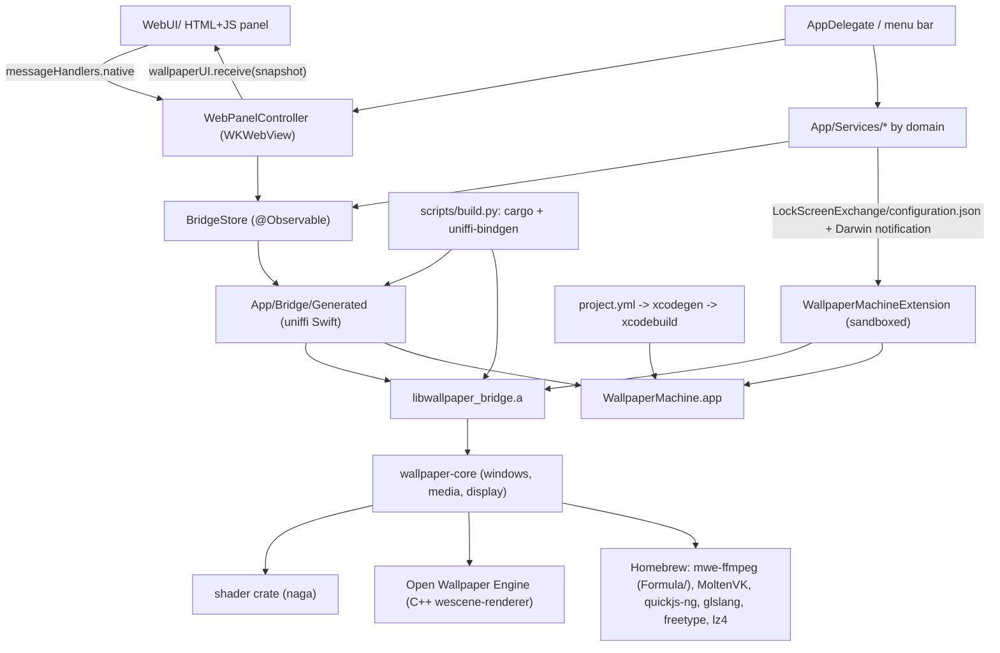

# Architecture

WallpaperMachine is a native macOS wallpaper client built on a vendored Rust/C++ renderer.
One application bundle embeds one ExtensionKit extension (lock screen and screen saver) and an
unlinked MediaRemote helper framework, and links a Rust static library that in turn statically
links a C++ scene renderer.

This document covers module boundaries and the runtime contracts between them. Product
behavior is documented per feature under [features/](README.md#product-features); the directory
map and placement rules are in [repository-layout.md](repository-layout.md).

## Component map

## Layers

### AppKit shell

`App/WallpaperEngineApp.swift` is the `@main` entry point and plain AppKit: there is no SwiftUI
`App` scene. Before AppKit starts it handles the internal `--wallpaper-import-picker` mode
(`WallpaperImportPickerHelper`, see [localization.md](localization.md#which-language-the-app-shows))
and applies a pending backup restore (`WallpaperBackupService.applyPendingRestore`); then it
installs `AppDelegate` and runs the loop.

`App/AppDelegate.swift` owns process lifecycle. It configures the Vulkan ICD
(`App/Bridge/BridgeEnvironment.swift` points `VK_ICD_FILENAMES` at the bundled
`MoltenVK_icd.json` when the variable is unset), prepares the app-support tree
(`ClientPaths.prepare()`), constructs `BridgeStore`, installs the status item, the application
menu and the screen-parameters observer, opens the control-panel window, and starts the
long-lived services (lock screen, desktop poster sync, presentation policy, playlist and
automation schedulers, the web and native-video wallpaper hosts, system media).

- **Activation policy.** `.accessory` while no control-panel, What's New or preview window is
  open, `.regular` while one is.
- **Menus.** The status item (`rebuildMenu`) offers Control Panel, playback and
  wallpaper-navigation actions, **Lock Screen** and Exit. Lock Screen calls the private
  `SACLockScreenImmediate` in login.framework, resolved with `dlsym` and left out when missing
  (`App/Services/Desktop/ScreenLock.swift`). The application menu holds the app menu
  (Settings…, Check for Updates…, Quit), **File → Close** (Command-W sends `performClose` to the
  key window) and **Edit**. What the navigation actions do is owned by
  [playlists](features/playlists.md) and [automation](features/automation.md).
- **Closing the panel.** `windowWillClose` releases the page and its WebKit processes; reopening
  builds a fresh view around the existing stores and navigation.
- **Shutdown.** `applicationShouldTerminate` returns `.terminateLater` and runs an ordered
  asynchronous teardown: lock-screen and desktop-poster restoration first (a failure cancels the
  quit), then import, update, SteamCMD, Workshop and pixiv work, and the renderer bridge last.
  The bridge's `Shutdown` also ends the load journal's in-flight record, so quitting during a
  load is not counted as a crash ([crash recovery](features/crash-recovery.md)). Each quit logs
  who asked for it (`QuitReason`: the user, an update, logout, restart, shutdown, a signal) and
  how long each stage took (`QuitTimings`); both are logging only and change no behavior
  ([diagnostics](features/diagnostics.md#why-the-app-quit)).
- **Hosted tests.** Under a hosted test run (`NSClassFromString("XCTestCase") != nil`) the
  delegate short-circuits: no services are created against the user's real app-support folder.

An explicitly opened preview window (`WallpaperPreviewWindowController`) is a regular window.
`App/Services/Preview/` gives it one isolated surface through `WallpaperPreviewSession`: a
separate WebKit page or a private Compatibility renderer attached to an ordinary `CAMetalLayer`
view (`App/Bridge/WallpaperPreviewBridge.h` imports the scene C API), never an engine display
assignment. The bridge's read-only preview export supplies the draft inputs, and preview
shutdown precedes renderer shutdown. Playback limits are in
[live preview](features/wallpaper-properties.md#live-preview).

### Control panel: WKWebView and the JavaScript bridge

The control-panel UI is HTML/CSS/JS in `WebUI/`, bundled as the app resource folder `WebUI`.
Swift hosts it, but the page is app-owned: the renderer never draws into this web view. Coding
rules for the page (CSP, escaping, icons, no bundler) are in [conventions.md](conventions.md#web-control-panel-webui).

| Piece | Responsibility |
|---|---|
| `App/Views/ControlPanel/ControlPanelView.swift` | SwiftUI container; `ControlPanelNavigation` (`SidebarSelection`, `targetDisplayID`, Settings section) shared with native menu commands |
| `App/Views/ControlPanel/ControlPanelWindow.swift` | Builds the window and owns its size floor |
| `App/Views/ControlPanel/WebControlPanel.swift` | `NSViewRepresentable` over `WKWebView`; `WebPanelController` coordinator, `WebPanelAssets` scheme handler, message proxy |
| `App/Views/ControlPanel/WebPanelSnapshot.swift` | Builds the `[String: Any]` state payload handed to the page |
| `App/Views/ControlPanel/WebPanelActions.swift` | Decodes and executes page-originated actions (`WebPanelRequest`) |
| `App/Views/ControlPanel/WebPanel<Feature>.swift` | One feature's share of the snapshot and actions (Automation, Backup, Compatibility, DisplayLayouts, ImagePlacement, LibraryOrganization, Pixiv, Presets); `WebPanelRecoveryBudget` limits WebContent restarts |
| `App/Views/ControlPanel/WebSignInWindow.swift` | Separate sign-in window for pixiv and Steam: a private website data store, of which the app reads only the session cookie |
| `App/Views/ControlPanel/WallpaperPreviewWindow.swift`, `WhatsNewViewController.swift` | Native preview window and release-notes window |
| `WebUI/index.html`, `panel.js`, `settings.js`, `welcome.js`, `theme.js`, `i18n.js`, `icons.js`, the per-feature modules and the three stylesheets | The page itself; `welcome.js` is the full-window first-run guide; `locales/` holds one catalog per language |

Protocol, both directions:

- **Assets.** `WebPanelAssets` is a `WKURLSchemeHandler` for the private `mwe-ui` scheme. The
  page loads from `mwe-ui://app/index.html`. Only an allowlisted set of bundled files is served
  (plus `locales/<tag>.js` for each language in `AppLanguage.supported`); a new `WebUI/` file
  must be added to that list. Library and download images are served by id from per-snapshot
  maps (`mwe-ui://preview/<wallpaperID>`, `thumbnail/`, `animated/`, `pixiv-thumbnail/`,
  `property-image/`), so no library path is exposed to the page. `index.html` carries a
  restrictive CSP (`default-src 'none'`, `connect-src 'none'`).
- **Swift to page.** `WebPanelController.snapshot()` produces one dictionary describing the whole
  UI, delivered by `callAsyncJavaScript("return window.wallpaperUI.receive(state)")`. Updates
  are coalesced through `scheduleUpdate()` and suppressed while the window is hidden,
  miniaturized or occluded. Observation is installed with
  `withObservationTracking { trackSnapshotDependencies() }`, so any observed store property the
  snapshot reads re-arms an update. Library rows are cached by their own inputs and carry
  `libraryRevision`: the first delivery and action replies include the complete list, progress
  pushes omit unchanged rows, and the page reuses only a matching revision, otherwise requesting
  a full snapshot through the delivery result. Reloading the document resets that agreement.
  The Settings energy readout is the one separate push, `window.wallpaperUI.energy(reading)`,
  sampled only while the window is visible on Settings; see
  [features/performance.md](features/performance.md#energy-use) and
  [per-wallpaper energy rating](features/performance.md#per-wallpaper-energy-rating).
- **Page to Swift.** `panel.js` calls `window.webkit.messageHandlers.native` with an `action`
  string plus arguments. The handler is a `WKScriptMessageHandlerWithReply`, so every action is
  answered with either a fresh snapshot or an error string. `WebPanelController.receive` rejects
  any message that is not from the main frame of the `mwe-ui://app` origin. Post actions from
  event handlers, never from a render path such as `settings.js` `draw()`. `send()` marks an
  action pending under a key that covers every tab (and every value of one property), and a
  repeated `navigate`, `property` or similar action waits on the one in flight; anything that
  can throw between marking the key and posting belongs inside the `try` whose `finally`
  releases it.
- **Theme and language.** `theme.js` and `i18n.js` read `window.__appTheme` and
  `window.__appLanguage`, injected as the panel's only `WKUserScript` at document start so the
  first paint is already correct; `window.appTheme.apply(theme)` runs on every snapshot.
- **Recovery.** `webViewWebContentProcessDidTerminate` reloads the page under
  `WebPanelRecoveryBudget`: three restarts within 120 seconds, and a ready handshake earns the
  budget back only after 60 seconds of stable operation. Past the budget, or on a load failure,
  a native `NSAlert` offers Reload. Navigation policy allows only the index URL; external links
  are filtered by `WebPanelController.allowedExternalURL`.

### Observable state

`App/ViewModels/BridgeStore.swift` is the `@MainActor @Observable` facade over the renderer. It
holds the `WallpaperBridge` handle and the cached snapshot values (`appSnapshot`,
`librarySnapshot`, `wallpaperOptionsSnapshot`, `monitorInformationSnapshot`, `settingsSnapshot`,
`snapshotRevision`, `libraryLoadState`), exposes async mutation calls, and publishes
`onSnapshotApplied` so `AppDelegate` can re-evaluate presentation policy and lock-screen state.
`BridgeStoreDisplayLayouts.swift` extends it with multi-display transfers.

User commands from the panel and the menu bar run one at a time through `BridgeStore.commands`
(`App/ViewModels/UserCommandQueue.swift`). A command given while another runs waits its turn
instead of failing; commands sharing a slot (selecting a wallpaper, switching one display's
wallpaper) keep only the newest waiting request, so rapid clicks apply the last choice. Favorite
and Show in Finder skip the queue, and delete confirmations are asked before queueing. Callers
outside the queue (downloads, imports) that reach an activation-guarded store wait for the
running apply rather than throw. Busy is a state the panel shows, never an error.

`App/ViewModels/WallpaperEditorState.swift` holds transient editor drafts (scaling text,
property text, expanded sections) that must not reach the renderer on every keystroke.
`App/Logging/AppLog.swift` writes Swift log lines straight into the bridge's log from any
thread and holds those logged before the bridge exists; see
[Logs and diagnostics reports](features/diagnostics.md).

### Service layer

Services are grouped by domain under `App/Services/`; each domain has a matching folder in
`Tests/Unit/`.

| Domain | Key types | Responsibility |
|---|---|---|
| `Appearance/` | `AppThemePreferences`, `AppThemeStore` | Mode/accent/tone preferences shared by AppKit and the page |
| `Automation/` | `AutomationCommand`, `AppAutomation`, `HotKeyPreferences`, `GlobalHotKeys`, `WallpaperFocusFilter`, `WallpaperAutomationStore/Planner/Scheduler/Controller`, `WallpaperSolarTimes`, App Intents in `WallpaperIntents.swift` and `WallpaperConfigurationIntents.swift` | Explicit commands through `AppDelegate.performAutomation`; per-display weekday/solar/appearance rules and temporary Focus choices through the shared command queue; see [features/automation.md](features/automation.md) |
| `Desktop/` | `DesktopSpaceWallpaperAPI`, `DesktopWallpaperLedger`, `DesktopWallpaperSync`, `WallpaperSpaceMonitor`, `WallpaperPresentationPolicy`, `WallpaperCoverageProbes`, `PlaybackPreferences`, `AppRuleMonitor`, `OtherAudioMonitor`, `SystemConditionMonitor`, `DisplayConfiguration`, `WallpaperDisplayTransfer` | Per-Space desktop picture control, original-wallpaper journal, still-poster sync, playback rules, per-display renderer suspension, display refresh and multi-display copy/swap |
| `Diagnostics/` | `RuntimeDiagnosticsSession`, `DiagnosticsBundle`, `SessionLedger`, `EnergyUsageMonitor`, `WallpaperEnergyRecorder` | Runtime counters, the diagnostics report, how the previous session ended, energy readout and per-wallpaper ratings; see [features/diagnostics.md](features/diagnostics.md) |
| `GitHub/` | `GitHubReleaseClient`, `AppUpdateStore`, `AppUpdateInstaller`, `WhatsNewStore` | GitHub Releases update check, download, in-place install; which what's-new announcements were shown |
| `Library/` | `ClientPaths`, `WallpaperImportService`, `LibraryImportStore`, `WallpaperDeletionService`, `StillImageWallpaper`, `WallpaperBackupService`, `WallpaperCollectionStore`, `WallpaperPresetStore`, `WallpaperHistoryStore` | App-support layout, non-destructive import (run for the app, not the panel page, so Finder and Dock drops import too), still pictures packaged as `web` wallpapers, guarded deletion, collections, presets, history, backup and restore |
| `Localization/` | `AppLanguage`, `AppLanguageStore` | Shipped-language registry and the language preference; see [localization.md](localization.md) |
| `LockScreen/` | `LockScreenWallpaperSelection`, `LockScreenWallpaperService`, `LockScreenExtensionRegistration` | System lock-screen selection overrides and configuration publishing |
| `NativeVideo/` | `NativeVideoAdmission`, `NativeVideoPlayer`, `NativeVideoWallpaperHost`, `NativeVideoWallpaperWindow` | AVFoundation video backend: admission rules (a refusal routes back to the scene engine), player and desktop window |
| `Pixiv/` | `PixivService`, `PixivTransport`, `PixivStore`, `PixivSessionStore`, `PixivDownloadQueue`, `PixivWallpaperPackager` | pixiv browsing, the signed-in session (keychain), downloads and packaging as still `web` wallpapers; see [features/pixiv.md](features/pixiv.md) |
| `Playlist/` | `WallpaperPlaylist`, `PlaylistPlanner`, `PlaylistStore`, `PlaylistScheduler` | Per-display rotation and day/night wallpapers, switched through the display's command slot; see [features/playlists.md](features/playlists.md) |
| `Preview/` | `WallpaperPreviewSession`, `WallpaperPreviewRequest`, `SceneWallpaperPreviewSurface`, `WebWallpaperPreviewSurface` | Isolated live-preview inputs, lifecycle and surfaces |
| `Steam/` | `SteamCMDRuntime`, `SteamCMDSetupStore` | SteamCMD discovery, download, validation, security approval |
| `Support/` | `SupportPromptStore` | The one-time support prompt after a downloaded wallpaper is applied |
| `SystemMedia/` | `DesktopMediaSession`, `SystemMediaProvider`, `SceneMediaSink` | One system now-playing session (MediaRemote adapter with AppleScript fallback) feeding web and scene wallpapers; see [features/media-integration.md](features/media-integration.md) |
| `UserAssets/` | `UserAssetStore`, `ManagedUserAssetStore`, `UserAssetWorker` | Importing, watching and picking for file/directory wallpaper properties |
| `WebWallpaper/` | `WebWallpaperHost`, `WebWallpaperWindow`, `WebWallpaperPage` | Desktop-level `WKWebView` windows for `type: "web"` projects, driven by the bridge's `webWallpapers()`; see [features/web-wallpapers.md](features/web-wallpapers.md) |
| `Workshop/` | `WorkshopService`, `WorkshopSource`, `WorkshopStore`, `WorkshopDownloader`, `WorkshopDownloadManager`, `WorkshopThumbnailCache`, `WorkshopUpdateStore` | Workshop query model and browse state, SteamCMD-driven downloads and their queue, previews for Discover tiles, updates of installed items; see [features/workshop-downloads.md](features/workshop-downloads.md) |

`ClientPaths` fixes the on-disk contract: everything lives under
`~/Library/Application Support/WallpaperMachine` (overridable with `WALLPAPER_MACHINE_HOME`),
with `Library/`, `SceneAssets/`, `SteamCMD/`, `UserAssets/` and `Cache/` beneath it. It exports
`WALLPAPER_MACHINE_SUPPORT_ROOT`, `_LIBRARY_ROOT`, `_ASSETS_ROOT` and `_USER_ASSETS_ROOT` so the
Rust side resolves the same paths.

### Desktop wallpaper windows and private-API handling

Three owners create live desktop windows. Scene wallpapers, and videos on the Compatibility
backend, are drawn by the Rust core: `upstream/renderer/crates/core/src/window.rs` defines the
`NSWindow` subclass `MWEWallpaperDesktopWindow` (a stable Objective-C name, deliberately
depended on by Swift) hosting a `CAMetalLayer` at a wallpaper window level. Web projects
(`MWEWebWallpaperDesktopWindow`, `App/Services/WebWallpaper/`) and videos on the native backend
(`MWENativeVideoDesktopWindow`, `App/Services/NativeVideo/`) get the same window shape from
Swift; the bridge excludes them from engine reconciliation and reports them through
`webWallpapers()` and `nativeVideoWallpapers()`. Every wallpaper window sets `canHide = false`,
so hiding the app (Cmd-H, or the panel hiding itself after an activation) hides only the panel;
with AppKit's default the wallpaper windows left the screen too and occlusion suspended every
display.

Multi-display user commands are coordinated above these windows by `WallpaperDisplayTransfer`
and `BridgeStoreDisplayLayouts`; `WallpaperDisplayLayoutStore` owns only saved wallpaper
choices, while playlists, properties and display topology stay with their existing owners. See
[display layouts](features/display-layouts.md).

Swift keeps the *system* wallpaper consistent with that window. `DesktopWallpaperSync` encodes real
renderer output into JPEG posters and installs them as the static desktop picture that Mission
Control shows; `DesktopWallpaperLedger` journals the user's original per-Space wallpaper before the
first write and restores it on quit; `DesktopSpaceWallpaperAPI` reaches the per-Space getter and
setter through optional private CoreGraphics and HIServices symbols, falling back to the public
`NSWorkspace` API. Timing, refusals, macOS 27 behavior and the quit wait are in
[desktop-picture](features/desktop-picture.md). Two more behaviors sit above the windows:

- **Presentation policy.** `WallpaperPresentationPolicy` suspends or unloads presentation when no
  wallpaper pixel can reach a display, without altering the user's play/pause choice. The
  strongest global condition wins: display sleep pauses (`setPresentationSuspended`) or stops
  and frees renderer memory (`setPresentationUnloaded`) per
  `PlaybackPreferences.displaySleepAction`; session lock, an active pause rule, or other-app
  audio set to pause suspend; an active stop rule unloads. The lock state comes from
  `CGSessionCopyCurrentDictionary`, a synchronous window-server round trip, so the policy asks
  only at start, on `com.apple.screenIsLocked`/`Unlocked`, on display wake and on a user
  switch, and at every evaluation while the session counts as locked. `AppRuleMonitor` and
  `OtherAudioMonitor` feed those conditions, and wallpaper audio is suppressed separately
  (`setAudioSuppressed`) for a mute rule or other-app audio set to mute. Occlusion is per display
  (`setDisplayPresentationSuspended`): one covered screen stops only its own decoding,
  simulation and rendering, and a visible screen never resumes a covered one. With
  `PlaybackPreferences.desktopCoveredAction` at its default, pause, a display whose working
  area other windows cover counts as hidden too: `WallpaperCoverageProbes` keeps one alpha-0,
  mouse-transparent window per display just above the wallpaper level, over `visibleFrame`
  inset by 32 pt, and the policy reads its occlusion. The bridge keeps `suspended_displays`
  beside the global flag, resolves each scene's and web descriptor's paused state from its own
  display, and re-applies the still-hidden displays after a global resume. System audio capture
  follows visible consumers, not the global pause flag.
- **Display changes.** Screen-parameter changes refresh displays through
  `DisplayRefreshCoalescer`: one refresh runs at a time and a burst that arrives meanwhile gets
  one more. A change that leaves `DisplayConfiguration` (AppKit's in-process copy of what
  `DisplayDesc::all()` reads from CoreGraphics: the screens in order, main first, and each
  one's display ID, frame, backing scale and refresh rate) as the last successful refresh read
  it refreshes nothing, so an XDR display's stream of EDR headroom changes does no bridge work.
  The Space monitor rereads Spaces only when `DisplayConfiguration` moved, and the presentation
  policy re-evaluates only when a screen frame or working area moved. A refresh reopens a scene
  only when its saved configuration changed: the frame-rate ceiling, transient mute, pause and
  system-audio gating are applied live and never count as a different wallpaper. Window-only
  updates compare the native geometry before writing it and commit without implicit layer
  animations, so moving a display or changing the primary does not redraw a window or reset an
  unchanged Metal drawable. Renderer windows and Metal layers default to opaque black rather
  than white, matching the native-video and web hosts.

### Renderer bridge (generated uniffi)

`App/Bridge/Generated/` holds `WallpaperBridge.swift`, `WallpaperBridgeFFI.h` and
`WallpaperBridgeFFI.modulemap`, generated by `uniffi-bindgen` from the Rust `wallpaper-bridge`
crate. Swift sees a `WallpaperBridge` object plus the `Bridge*` value types
(`BridgeAppSnapshot`, `BridgeLibrarySnapshot`, `BridgeSettingsSnapshot`,
`BridgeWallpaperOptionsSnapshot`, `BridgeMonitorInformationSnapshot`, `BridgePropertyDescriptor`,
`BridgeScalingMode`, `BridgeLockScreenScene`, `BridgeError`, …). The `WallpaperMachine` and
`WallpaperMachineTests` targets consume it through `SWIFT_INCLUDE_PATHS`, `HEADER_SEARCH_PATHS`
and `-Xcc -fmodule-map-file=…/WallpaperBridgeFFI.modulemap`; the two generated FFI files are
excluded from the compile sources and reached through the module map instead. Regeneration and
the never-edit rule are in [conventions.md](conventions.md#swift) and [build.md](build.md).

Every snapshot the bridge returns carries the launch-at-login status, which the bridge's
`LaunchAtLoginController` reads from `SMAppService` (a round trip to the system's service
manager) and keeps for two seconds.

### Rust crates and the C++ scene engine

`upstream/renderer` is a Cargo workspace (`resolver = "2"`, edition 2024, GPL-2.0-only) with
three members:

| Crate | Output | Role |
|---|---|---|
| `crates/bridge` (`wallpaper-bridge`, lib name `wallpaper_bridge`) | `staticlib` + `rlib`, plus the `uniffi-bindgen` binary | uniffi API surface (`api/`), kameo actor (`actor/`), engine facade (`engine/`), config store (`config/`), library scanner (`library/`), display rows (`display/`), user assets, logging, login item, power |
| `crates/core` (`wallpaper-core`) | `rlib` | Runtime state machine (`engine/`): scene reconciliation, display discovery and watching, wallpaper windows, media decode (`media/video`, `media/audio` capture for audio response), render cache, and the `owe` FFI wrappers |
| `crates/shader` (`shader`) | `rlib` + `staticlib` | GLSL parsing/translation via `naga`, exposed to C++ through the `ffi` feature |

`crates/core/build.rs` drives the C++ layer: it runs `bindgen` over
`upstream/renderer/external/open-wallpaper-engine/src/Platform/Apple/SceneWallpaperBindings.h`,
then CMake-builds the `wescene-renderer` target of Open Wallpaper Engine with `BUILD_TESTING`
and `BUILD_TESTS` off and `RUST_SHADER_FFI` on, and emits the static link flags. Open Wallpaper
Engine is only the statically linked renderer backend behind bindgen-generated
`extern "C-unwind"` calls; `core/src/owe/` is deliberately not a runtime layer, and runtime
state lives in `WallpaperEngine` (`core/src/engine/`).

Per-display configuration (`[[monitors]]` and `[[monitor_settings]]` in `config.toml`) is keyed
by a selector: the primary display, a live display id, or an identity (UUID, vendor, model,
serial, unit number, name). `DisplayIdentity::match_score` in core is the one rule for whether
an identity names a display. A UUID both sides carry decides on its own, then vendor, model and
serial; the unit number is a last resort that never overrides a UUID or serial that disagrees.
macOS renumbers displays and renames identical models ("Name (1)", "Name (2)") across reboots
and reconnects, so display sync (`AppConfig::sync_known_monitors`) keeps one block per display,
renamed to its current selector, and settings entries and mirror targets follow.

The bridge also keeps a load journal (`engine/load_journal.rs`, `load-journal.json` beside
`config.toml`) of the scenes `reconcile_with` is about to open. A wallpaper that was being
opened when the process died in two launches in a row is left out of every activation plan
(`ActivationInputs::held`) until the user applies it again or the build changes; nothing is
deleted. `ClientPaths.prepare()` names the build for it through `WALLPAPER_MACHINE_BUILD`.
`BridgeAppSnapshot.held_wallpaper_ids` lists the held wallpapers a display is assigned to, which
`BridgeStore.heldWallpaperIDs` hands to the panel banner and the menu-bar line, and
`WallpaperBridge.release_held_wallpaper` is the panel's **Try again**.
See [crash recovery](features/crash-recovery.md).

Pointer polling follows committed native scene capability, not a manifest or a first-frame
notification. Pure video projects publish no pointer consumer, ordinary and not-yet-committed
scenes remain conservative, and a paused scene (user, policy or its own display covered) is not
a consumer. A bounded, event-driven relay carries a retained renderer-instance identity into
the core actor. The bridge's single-in-flight poller is armed by the engine's global and local
`NSEvent` monitors (buttons, moves, drags), a new consumer, a resume or a reset of a runtime's
pointer delivery, and samples at most once per 16 ms; while the app is active, or when a
monitor could not be installed, it probes the cursor with `CGEventCreate` every 16 ms instead
and skips the actor round trip when nothing changed. One sample delivers enter, position and
ordered button transitions in one actor turn. These are Rust/native runtime contracts, not
persisted or uniffi snapshot fields.

Each renderer also reports whether its committed scene reads system audio through
`owe_scene_wallpaper_set_audio_requirement_callback`. The report travels like pointer
capability: a latest-value relay per renderer object into the core actor, an observer on
snapshot publication, and a bridge relay that re-evaluates capture. The system-audio tap runs
only for `audio_response_enabled && scene reads audio && !paused`, or for a subscribed web page,
so plain video wallpapers never open it; see [audio response](features/audio-response.md).

### Lock-screen extension

`Extension/` builds `WallpaperMachineExtension`, an `extensionkit-extension` target for the
`com.apple.wallpaper` extension point (`Extension/Info.plist`). It is a separate, sandboxed
process; the app cannot call into it directly. The protocol it speaks is private and is verified
only on macOS 26 and later (`LockScreenConfiguration.isSupportedBySystem`).

| File | Responsibility |
|---|---|
| `WallpaperExtension.swift` | `@main AppExtension`; XPC handler for `acquire`/`update`/`invalidate`/`snapshot`/`provideSettingsViewModels`/`isChoiceDownloaded`/`selectedChoicesDidChange`, and connection acceptance |
| `WallpaperRuntime.swift` | Loads and checks the private hosting ABI, verifies the caller's code signature via its audit token, resolves `CAContext`, reads the published configuration and asset paths, logging |
| `WallpaperController.swift` | Singleton surface registry; reacts to screen sleep/wake, `com.apple.screenIsLocked`/`Unlocked`, and the Darwin notification `app.wallpapermachine.lock-screen.changed` |
| `WallpaperSurface.swift` | One `WallpaperID` to one `CAContext` with a scene/video `CAMetalLayer` or live WebKit layer tree; bounded geometry, readiness and snapshots |
| `WallpaperSettingsProvider.swift` | Encodes the private wallpaper settings view-model payload |
| `WallpaperExtensionBridge.h` | Objective-C bridging header declaring the private `CAContext`, `NSXPCConnection.auditToken` and the XPC protocol; also includes `SceneWallpaperBindings.h` |

The process boundary is a file boundary. `Shared/` compiles into both targets and holds the
contracts they must agree on:

- `LockScreenConfiguration` defines the published contract: the app writes a complete immutable
  `LockScreenConfiguration` (version, revision, `[LockScreenScene]` with paths relative to the
  exchange directory) as `configuration.json` into
  `~/Library/Application Support/WallpaperMachine/LockScreenExchange/`, then posts
  `LockScreenConfiguration.changedNotification`. The extension reloads and writes
  `LockScreenReadiness` back once a GPU-ready non-preview surface exists, or with the error when
  acquiring or replacing that surface's renderer failed.
- `LockScreenExtensionStatus` is a separate diagnostic exchange (`activation-request.json`,
  `extension-status.json`) that reports a configuration error even when the scene schema cannot
  be decoded; configuration success never substitutes for a rendered-frame acknowledgement. See
  [When activation fails](features/lock-screen.md#when-activation-fails).
- `WallpaperPresentationAuthority` decides which surface roles may keep presenting, and why not,
  so a preview or lock-screen instance cannot render for nobody; `RuntimeCounters` holds
  time-limited, per-surface runtime counters for power work, off by default (see
  [testing/power-benchmark.md](testing/power-benchmark.md)).
- `ScreenSaverWebSurface` and `WebWallpaperProtocol` host and describe web wallpapers for the
  screen saver (selected by `LockScreenScene.webEntryFile`); `LockScreenSurfaceRegistry`,
  `LockScreenFrameBacking` and `LockScreenIdleExit` manage surface lifecycle, pixel backing and
  the extension process's exit once nothing uses it, so the next launch runs the registered copy.

Rules of the exchange:

- The version-2 manifest carries independent `lockScreenEnabled` and `screenSaverEnabled` flags.
  The single service journals Desktop and Idle ownership separately; only Desktop ownership
  suspends desktop poster sync, and an Idle-only selection is committed without waiting for an
  unshown surface to be acquired. The bridge exports committed scenes, videos and web projects
  independently of desktop routing or suspension.
- A scene's `paused` carries only the user's Play/Pause and power policy: the desktop display
  being suspended, which locking causes by covering it, is not a reason for the lock screen to
  hold still.
- The app never touches the extension's sandbox container: on macOS 15+ an ad-hoc-signed app
  reaching into another app's container triggers the "would like to access data from other apps"
  prompt on every launch. The extension never reads draft options or the app's private
  configuration files, and it publishes no external URLs.
- `Extension/WallpaperExtension.entitlements` enables the App Sandbox with network-client
  access, a read-only exception for `/opt/homebrew/` (which lets the sandboxed process load the
  Homebrew-provided renderer dylibs) and a read-write home-relative exception for the exchange
  directory only (`LockScreenConfiguration.exchangeRelativePath` must match it).
- Web wallpapers in the extension get a project-specific WebKit file grant, never the common
  revisions directory. Network-client access allows wallpaper resources, but capture, audio and
  author dialogs are disabled. The page's un-ordered scheduling window does not present on the
  desktop; the existing remote context owns the live layer tree, and suspension freezes it,
  accelerated content included. Web surface errors enter the existing readiness channel.

User-facing behaviour: [features/lock-screen.md](features/lock-screen.md).

## Build and linking

`scripts/build.py` runs the whole chain: `cargo build --workspace --release` in
`upstream/renderer` (which also bindgen-generates the Open Wallpaper Engine bindings and
CMake-builds `wescene-renderer`), `uniffi-bindgen generate` into `App/Bridge/Generated`,
`xcodegen generate`, then `xcodebuild`. The environment, modes (`--swift-only`,
`--renderer-only`), outputs and packaging are owned by [build.md](build.md).

Both the app and the extension link the same renderer flag set (`project.yml` anchors
`rendererLibraryPaths` and `rendererLinkerFlags`): `-lwallpaper_bridge`, the C++ runtime, Vulkan
(`-lvulkan`), `-llz4`, `-lfreetype`, the FFmpeg libraries, `-lqjs` (quickjs-ng), the glslang and
SPIRV libraries, `-liconv` and the system frameworks. Library search paths point at
`upstream/renderer/target/release` and the Homebrew prefixes. The FFmpeg libraries come from
`Formula/mwe-ffmpeg.rb`, not Homebrew's GPLv3 `ffmpeg@8`; `libSPIRV` loads Apache-2.0
SPIRV-Tools and `libvulkan` opens the Apache-2.0 MoltenVK ICD, which keeps the bundle from being
distributable ([../LICENSING.md](../LICENSING.md#remaining-blockers)). A freshly built app
therefore still depends on Homebrew until `scripts/package.py` bundles those libraries
([build.md](build.md#packaging-and-installing)).

## Ours versus vendored

| Path | Origin |
|---|---|
| `App/`, `Extension/`, `Shared/`, `WebUI/`, `Tests/`, `scripts/`, `Formula/`, `project.yml` | This project, GPL-2.0-only (root `LICENSE`); `App/` is a derived work of the renderer's former `app/WallpaperEngine` |
| `App/Bridge/Generated/` | Build output of the vendored bridge crate |
| `upstream/renderer/` | Fork of `bigsaltyfishes/wallpaper-engine-for-macos`, GPL-2.0-only, modified |
| `upstream/renderer/external/open-wallpaper-engine/` | Fork of `bigsaltyfishes/open-wallpaper-engine`, modified; vendors Apache-2.0 `spirv_reflect` and public-domain/MIT-0 `miniaudio` under `third_party/` |
| `upstream/mediaremote-adapter/` | `ungive/mediaremote-adapter`, BSD-3-Clause, modified (see `upstream/provenance.json`) |

`upstream/provenance.json` records the repositories, pinned revisions, modification status and
the current `distributionStatus`. The Workshop browser is recorded there and in
[../LICENSING.md](../LICENSING.md) as independently implemented. Licence policy, the Supporter
model and the open distribution blockers live in `LICENSING.md`; which notices `scripts/package.py`
bundles is in [build.md](build.md#packaging-and-installing).

## Targets

| Target | Type | Sources | Notes |
|---|---|---|---|
| `WallpaperMachine` | application | `App/`, `Shared/`, `Resources/StarterWallpaper`, `WebUI` and `CHANGELOG.md` as resources, the MediaRemote adapter's Perl script and license | Embeds the extension and `MediaRemoteAdapter.framework`; uses `App/Resources/Info.plist` verbatim; `App/Resources/InfoPlist.xcstrings` is excluded from the build |
| `MediaRemoteAdapter` | framework | `upstream/mediaremote-adapter/src` and `include` | Embedded in the app but not linked; the app runs its Perl entry point only while a wallpaper has media integration on |
| `WallpaperMachineExtension` | extensionkit-extension | `Extension/`, `Shared/`, the starter preview image | Sandboxed, `APPLICATION_EXTENSION_API_ONLY`, Objective-C bridging header |
| `WallpaperMachineTests` | bundle.unit-test | `Tests/Unit/` | Hosted in the app binary (`TEST_HOST`/`BUNDLE_LOADER`) |
| `WallpaperMachineUITests` | bundle.ui-testing | `Tests/UI/` | Separate runner, `TEST_TARGET_NAME: WallpaperMachine` |

Schemes: `WallpaperMachine` (run + unit tests) and `WallpaperMachineUI` (UI tests).

## Invariants and constraints

Repository rules (`project.yml` as the source of truth, generated bindings, what `Shared/` may
contain, version bumps) are in [conventions.md](conventions.md) and `AGENTS.md`. The runtime
invariants:

- The extension is sandboxed and API-extension-only. Its only inputs are the published
  `configuration.json` and assets in the exchange directory, and its read-only Homebrew
  exception. It never reads draft state or app-private files.
- The extension accepts an XPC connection only after verifying the caller's code signature, and
  every private-ABI assumption is checked against the loaded system classes: no fallback
  offsets, no process injection, no lock-screen window impersonation.
- Private desktop/Space APIs are resolved with `dlsym` and are always optional: failure falls
  back to the public `NSWorkspace` API.
- The user's original wallpaper is journalled before replacement, and the lock-screen selection
  edits only explicit per-display overrides.
- The control panel's web view loads only `mwe-ui://app/index.html` from the bundle; renderer
  content is never loaded into it, and page messages are accepted only from that origin's main
  frame.
- Snapshot updates are suppressed while the panel is not visible, and the page is driven by
  whole snapshots (unchanged library rows may be omitted by revision; the energy readout is the
  one separate push).
